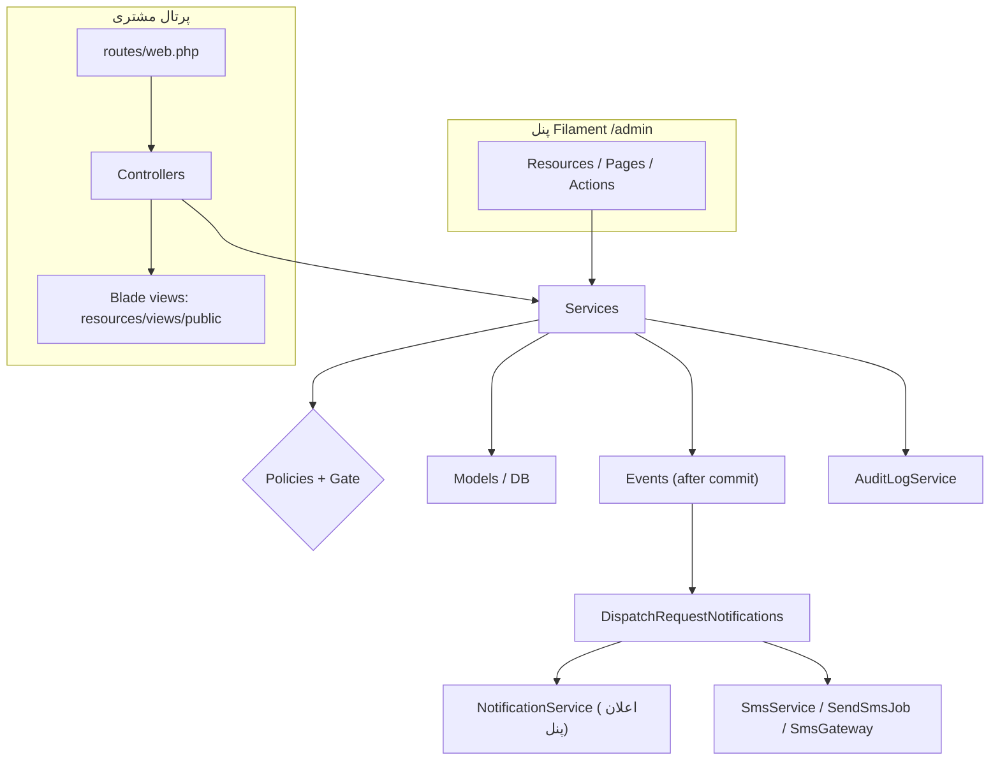
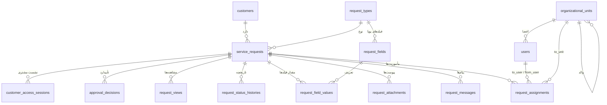
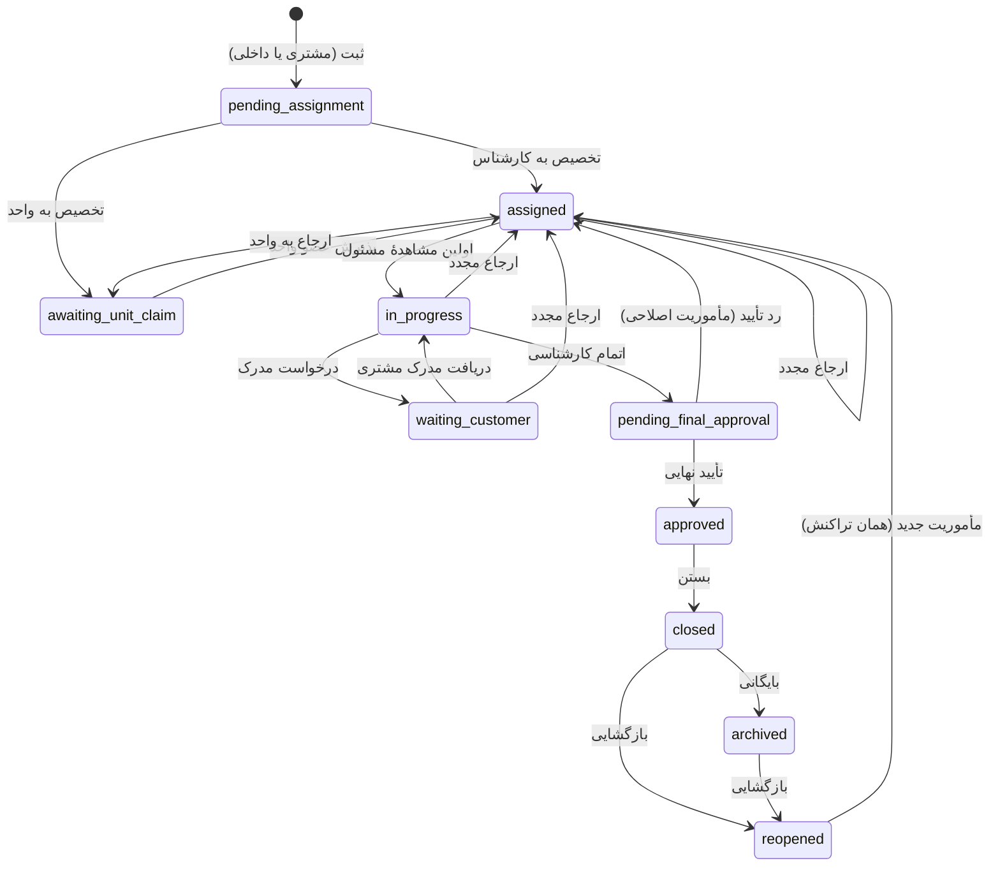
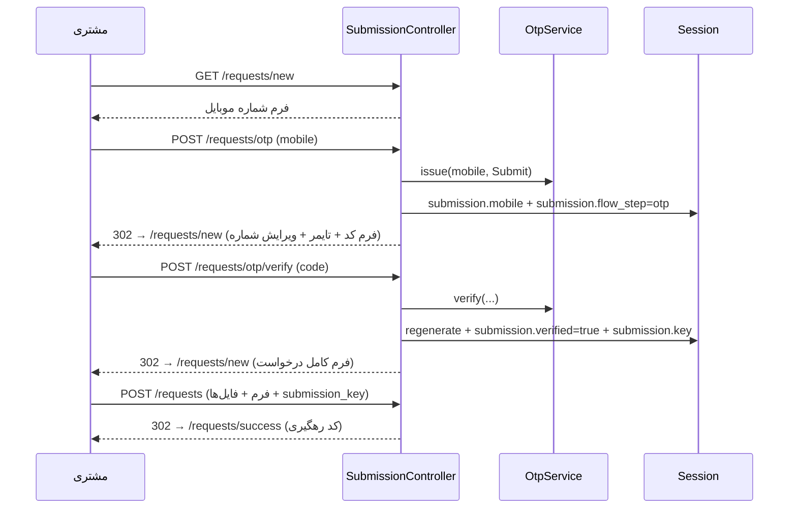

# مستند توسعهٔ سامانه مدیریت درخواست مشتریان (CRM)

> مخاطب: توسعه‌دهندهٔ لاراول در سطح متوسط که می‌خواهد بدون دانش قبلی از این پروژه، هر بخش را تغییر دهد یا توسعه بدهد.
>
> این سند با نسخهٔ **1.2.17** (فایل `VERSION`) هماهنگ است. اگر کد را تغییر دادید و رفتار یا مسیر فایلی عوض شد، همین سند را هم به‌روز کنید.

---

## فهرست

- [۰. این سند را چطور بخوانیم](#۰-این-سند-را-چطور-بخوانیم)
- [۱. سامانه چه کار می‌کند](#۱-سامانه-چه-کار-میکند)
- [۲. فناوری‌ها و نسخه‌ها](#۲-فناوریها-و-نسخهها)
- [۳. راه‌اندازی محیط توسعه](#۳-راهاندازی-محیط-توسعه)
- [۴. ساختار پوشه‌ها](#۴-ساختار-پوشهها)
- [۵. معماری و قواعد طلایی](#۵-معماری-و-قواعد-طلایی)
- [۶. مدل داده (جداول و رابطه‌ها)](#۶-مدل-داده-جداول-و-رابطهها)
- [۷. Enumها](#۷-enumها)
- [۸. گردش کار درخواست (State Machine)](#۸-گردش-کار-درخواست-state-machine)
- [۹. لایهٔ سرویس‌ها](#۹-لایهٔ-سرویسها)
- [۱۰. پرتال عمومی مشتری](#۱۰-پرتال-عمومی-مشتری)
- [۱۱. OTP و پیامک](#۱۱-otp-و-پیامک)
- [۱۲. پنل کارکنان (Filament)](#۱۲-پنل-کارکنان-filament)
- [۱۳. نقش‌ها، مجوزها و Policyها](#۱۳-نقشها-مجوزها-و-policyها)
- [۱۴. تنظیمات سامانه (config / دیتابیس / env)](#۱۴-تنظیمات-سامانه-config--دیتابیس--env)
- [۱۵. رویدادها و اعلان‌ها](#۱۵-رویدادها-و-اعلانها)
- [۱۶. SLA (مهلت رسیدگی) و گزارش‌ها](#۱۶-sla-مهلت-رسیدگی-و-گزارشها)
- [۱۷. فایل‌ها و پیوست‌ها](#۱۷-فایلها-و-پیوستها)
- [۱۸. حسابرسی (Audit Log)](#۱۸-حسابرسی-audit-log)
- [۱۹. فرانت‌اند (Blade، Tailwind، JS، تقویم شمسی)](#۱۹-فرانتاند-blade-tailwind-js-تقویم-شمسی)
- [۲۰. ابزارهای کمکی (Support)](#۲۰-ابزارهای-کمکی-support)
- [۲۱. دستورات Artisan، صف و زمان‌بند](#۲۱-دستورات-artisan-صف-و-زمانبند)
- [۲۲. تست‌ها](#۲۲-تستها)
- [۲۳. دستورالعمل‌های توسعه: «برای تغییر X کدام فایل‌ها؟»](#۲۳-دستورالعملهای-توسعه-برای-تغییر-x-کدام-فایلها)
- [۲۴. دام‌ها و نکات حیاتی](#۲۴-دامها-و-نکات-حیاتی)
- [۲۵. استقرار و نسخه‌گذاری](#۲۵-استقرار-و-نسخهگذاری)
- [۲۶. واژه‌نامه](#۲۶-واژهنامه)
- [پیوست الف: فهرست کامل فایل‌ها](#پیوست-الف-فهرست-کامل-فایلها)
- [پیوست ب: نقشهٔ مسیرها (Routes)](#پیوست-ب-نقشهٔ-مسیرها-routes)
- [پیوست ج: کلیدهای Session و Cookie](#پیوست-ج-کلیدهای-session-و-cookie)

---

## ۰. این سند را چطور بخوانیم

- اگر تازه وارد پروژه شده‌اید: بخش‌های ۱ تا ۸ را به ترتیب بخوانید. بعد از آن تصویر کامل سامانه را دارید.
- اگر کار مشخصی دارید (مثلاً «یک فیلد به فرم اضافه کنم»): مستقیم به [بخش ۲۳](#۲۳-دستورالعملهای-توسعه-برای-تغییر-x-کدام-فایلها) بروید. برای هر کار، فهرست کامل فایل‌هایی که باید عوض شوند آمده است.
- قبل از هر تغییر، [بخش ۲۴ (دام‌ها)](#۲۴-دامها-و-نکات-حیاتی) را یک بار مرور کنید. بیشتر باگ‌های گذشتهٔ این پروژه از همین موارد بوده‌اند.
- سندهای دیگر مخزن:
  - `README.md` — نصب سریع و تصمیم‌های معماری به‌صورت خلاصه
  - `WORKFLOW.md` — جدول وضعیت‌ها و مجوزها (نسخهٔ کسب‌وکاری)
  - `SECURITY.md` — قواعد امنیتی و چک‌لیست انتشار
  - `DEPLOYMENT.md` — استقرار روی سرور (Runflare)، SMS.ir، عیب‌یابی
  - `CHANGELOG.md` — تاریخچهٔ نسخه‌ها
  - `AGENTS.md` — قواعد کدنویسی (Laravel Boost) که برای انسان هم معتبر است

---

## ۱. سامانه چه کار می‌کند

سامانه برای **ثبت، پیگیری، ارجاع، رسیدگی و تأیید نهایی درخواست‌های مشتریان** (مثل شکستگی کالا، مغایرت یا کسری اقلام) ساخته شده است. دو «سطح» کاملاً جدا دارد:

| سطح | آدرس | کاربر | فناوری | احراز هویت |
| --- | --- | --- | --- | --- |
| پرتال عمومی مشتری | `/`، `/requests/new`، `/track`، `/about`، `/contact`، `/privacy` | مشتری (بدون حساب کاربری) | کنترلر لاراول + Blade + فرم‌های POST ساده | OTP پیامکی روی موبایل |
| پنل کارکنان | `/admin` | کارکنان (کارشناس، مدیر، ناظر) | Filament 5 (روی Livewire 4) | ایمیل/رمز یا OTP موبایل |

### چرخهٔ عمر یک درخواست به زبان ساده

1. مشتری شماره موبایل را وارد می‌کند، کد OTP می‌گیرد و تأیید می‌کند.
2. فرم درخواست را پر می‌کند (نوع درخواست، تاریخ خرید، شرح، فیلدهای اختصاصی، مدارک) و **کد رهگیری** مثل `RQ-AB12CD34EF` می‌گیرد.
3. درخواست در پنل با وضعیت «در انتظار تخصیص» ظاهر می‌شود.
4. مدیر آن را به یک **کارشناس** یا یک **واحد سازمانی** ارجاع می‌دهد (هر ارجاع = یک «مأموریت» یا `RequestAssignment`).
5. کارشناس پرونده را باز می‌کند (وضعیت خودکار «در حال رسیدگی» می‌شود)، توضیح می‌نویسد، در صورت نیاز از مشتری مدرک می‌خواهد، و در پایان «اتمام کارشناسی» می‌زند.
6. مدیر تأیید نهایی می‌کند (و معمولاً همزمان می‌بندد) یا رد می‌کند و پرونده برای اصلاح برمی‌گردد.
7. پرونده بسته و در صورت نیاز بایگانی یا بازگشایی می‌شود.
8. مشتری در تمام این مدت با کد رهگیری + OTP وضعیت را می‌بیند و اگر از او مدرک خواسته شده باشد، فایل می‌فرستد.

---

## ۲. فناوری‌ها و نسخه‌ها

| بخش | بسته / ابزار | نسخه |
| --- | --- | --- |
| زبان | PHP | 8.3 |
| فریم‌ورک | `laravel/framework` | 13 |
| پنل ادمین | `filament/filament` | 5 |
| کامپوننت‌های تعاملی پنل | Livewire (همراه Filament) | 4 |
| نقش و مجوز | `spatie/laravel-permission` | 8 |
| تاریخ شمسی (PHP) | `morilog/jalali` | 3 |
| CSS | Tailwind CSS (از طریق `@tailwindcss/vite`) | 4 |
| باندلر | Vite + `laravel-vite-plugin` | 8 / 3 |
| تقویم شمسی (JS) | `@majidh1/jalalidatepicker` | 1 |
| تست | PHPUnit | 12 |
| فرمت کد | Laravel Pint | 1 |

> قاعده: بسته‌ای اضافه یا حذف نکنید مگر با هماهنگی (طبق `AGENTS.md`). قبل از استفاده از API یک بسته، نسخهٔ نصب‌شده را با `composer show <package>` بررسی کنید.

---

## ۳. راه‌اندازی محیط توسعه

### نصب

```bash
composer install
cp .env.example .env
php artisan key:generate
touch database/database.sqlite          # توسعه روی SQLite
php artisan migrate --seed               # جداول + نقش‌ها + تنظیمات + انواع درخواست + قالب پیامک + SLA + مدیر پیش‌فرض
npm install
npm run build                            # یا npm run dev برای hot reload
php artisan serve
```

- پنل: `http://127.0.0.1:8000/admin` — کاربر پیش‌فرض: `admin` (یا `admin@admin.com`) با رمز `admin` (از `config/crm.php` و متغیرهای `CRM_DEFAULT_ADMIN_*`).
- پرتال: `http://127.0.0.1:8000`
- دادهٔ نمایشی کامل (۱۰ درخواست، واحدها، کارشناسان): `php artisan crm:seed-demo` و سپس `storage/app/demo-credentials.txt`.

### OTP در محیط توسعه بدون SMS.ir

در `.env`:

```dotenv
SMS_GATEWAY=log
CRM_OTP_DEBUG=true
```

با `SMS_GATEWAY=log` کلاس `App\Sms\LogOtpSender` به‌جای ارسال واقعی، پیام را در حافظه (`LogSmsGateway::$captured`) نگه می‌دارد. با `CRM_OTP_DEBUG=true` کد OTP در `storage/logs/laravel.log` با کلید `crm.otp_debug` نوشته می‌شود:

```bash
tail -f storage/logs/laravel.log | grep crm.otp_debug
```

> `LogOtpSender` در `APP_ENV=production` عمداً استثنا می‌دهد تا در تولید اشتباهاً OTP «ارسال‌نشده» موفق فرض نشود.

### اجرای همزمان سرویس‌ها

```bash
composer run dev            # سرور + vite + ... (php artisan dev)
php artisan queue:work      # برای پیامک‌های اطلاع‌رسانی (صف)
php artisan schedule:work   # پاک‌سازی روزانهٔ OTPهای منقضی
```

### تست و فرمت

```bash
php artisan test --compact                       # همهٔ تست‌ها (SQLite حافظه‌ای)
php artisan test --compact --filter=PublicOtpFlowTest
vendor/bin/pint --dirty                          # فرمت فایل‌های تغییرکرده
```

---

## ۴. ساختار پوشه‌ها

فقط پوشه‌هایی که در توسعه با آن‌ها سروکار دارید:

```text
app/
├── Console/Commands/      دستورات artisan سفارشی (crm:install، crm:create-admin، ...)
├── Contracts/             اینترفیس‌ها (SmsOtpSender)
├── Enums/                 همهٔ وضعیت‌ها و انواع (RequestStatus، FieldType، ...)
├── Events/                رویدادهای دامنه (ServiceRequestSubmitted، ...)
├── Exceptions/            WorkflowException (خطای کسب‌وکاری قابل نمایش) و RetryableSmsException
├── Filament/              کل پنل کارکنان
│   ├── Auth/Login.php         صفحهٔ ورود (ایمیل/رمز + OTP موبایل)
│   ├── Forms/Components/      کامپوننت فرم سفارشی (JalaliDateInput)
│   ├── Pages/                 صفحات مستقل (تنظیمات، گزارش‌ها)
│   ├── Resources/             CRUDها (هر Resource یک پوشه)
│   └── Widgets/               ویجت داشبورد
├── Http/
│   ├── Controllers/       کنترلرهای پرتال عمومی + دانلود پیوست
│   ├── Middleware/        هدرهای امنیتی، تنظیم کوکی Secure، کنترل فعال بودن کارمند
│   └── Requests/          FormRequest فرم ثبت درخواست مشتری
├── Jobs/                  SendSmsJob (ارسال پیامک اطلاع‌رسانی در صف)
├── Listeners/             DispatchRequestNotifications (همهٔ اعلان‌ها از اینجا)
├── Models/                مدل‌های Eloquent
├── Notifications/         StaffAlertNotification (اعلان داخل پنل)
├── Policies/              قواعد دسترسی هر مدل
├── Providers/             AppServiceProvider و AdminPanelProvider (Filament)
├── Services/              ★ منطق کسب‌وکار — مهم‌ترین پوشه
├── Sms/                   درگاه‌های پیامک و ارسال‌کننده‌های OTP
└── Support/               ابزارهای کمکی (موبایل، تاریخ شمسی، کد رهگیری، کاتالوگ مجوزها)

bootstrap/app.php          تنظیم middleware سراسری و مسیرها
bootstrap/providers.php    ثبت ServiceProviderها
config/crm.php             ★ پیش‌فرض‌های کسب‌وکاری سامانه
config/sms.php             ★ تنظیمات درگاه پیامک و SMS.ir
database/
├── factories/             factory برای همهٔ مدل‌ها (در تست‌ها)
├── migrations/            ساختار جداول
└── seeders/               دادهٔ پایه (نقش‌ها، تنظیمات، انواع درخواست، قالب پیامک، SLA، مدیر، demo)
lang/fa/validation.php     پیام‌های فارسی اعتبارسنجی
public/vendor/jalali-datepicker/   فایل‌های آمادهٔ تقویم شمسی
public/fonts/yekan/        فونت یکان‌بخ
resources/
├── css/app.css            ★ استایل پرتال عمومی (کلاس‌های crm-*)
├── css/filament/admin/theme.css   تم پنل Filament
├── js/app.js              JS پرتال (فقط تقویم شمسی)
├── js/jalali-datepicker.js    اتصال تقویم شمسی به inputهای data-jdp
├── js/filament-jalali.js  همان تقویم برای پنل
└── views/
    ├── public/            ★ همهٔ صفحات پرتال مشتری
    ├── components/        کامپوننت Blade (x-jalali-date-input)
    ├── filament/          viewهای سفارشی پنل (تب ورود، خلاصهٔ گزارش، assetهای تقویم)
    ├── partials/          assetهای مشترک تقویم
    └── errors/            صفحات خطای فارسی (403، 404، 419، 429، 500)
routes/web.php             ★ همهٔ مسیرهای پرتال (پنل مسیر خودش را دارد)
routes/console.php         زمان‌بندی (schedule)
tests/                     Feature و Unit
```

---

## ۵. معماری و قواعد طلایی

### نمای لایه‌ای



### قواعد طلایی (اگر فقط یک بخش را به خاطر بسپارید)

1. **منطق کسب‌وکار فقط در `app/Services`.** کنترلرها و اکشن‌های Filament فقط ورودی را می‌گیرند و یک متد سرویس را صدا می‌زنند. نمونه: دکمهٔ «تخصیص» در `ViewServiceRequest` فقط `AssignmentService::assignInitial()` را صدا می‌زند.
2. **وضعیت و مسئول پرونده را هرگز مستقیم عوض نکنید.** ستون‌های `status`، `current_assignment_id`، `current_owner_id`، `current_unit_id`، `approved_by`، `approved_at`، `closed_at`، `archived_at` در مدل `ServiceRequest` محافظت شده‌اند. هر `save()` که این‌ها را تغییر دهد و داخل `withinWorkflow()` نباشد، `WorkflowException` می‌دهد. تغییر وضعیت فقط با `WorkflowService::transition()` و تغییر مسئول فقط با `AssignmentService`.
3. **دسترسی همیشه با مجوز (permission) بررسی می‌شود، نه با نام نقش.** هر سرویس اول `Gate::forUser($actor)->authorize('ability', $request)` می‌زند. Policy هم مجوز را چک می‌کند و هم وضعیت پرونده را.
4. **خطای قابل نمایش به کاربر = `WorkflowException`** با پیام فارسی. این استثنا گزارش (log) نمی‌شود و در وب با `back()->with('error', ...)` نمایش داده می‌شود. در پنل، متد `run()` در `ViewServiceRequest` آن را به Notification قرمز تبدیل می‌کند.
5. **هر عملیات حساس داخل `DB::transaction` با `lockForUpdate`** روی ردیف پرونده انجام می‌شود تا دو کاربر همزمان یک پرونده را خراب نکنند.
6. **رویدادها بعد از commit اجرا می‌شوند** (`ShouldDispatchAfterCommit`). اعلان و پیامک فقط وقتی می‌رود که تراکنش واقعاً ذخیره شده باشد.
7. **هر تغییر مهم در `audit_logs` ثبت می‌شود** (`AuditLogService::record()`). کلیدهای حساس (password، otp، code، token، ...) خودکار حذف می‌شوند.
8. **هر شماره موبایل از `MobileNumber::normalize()` عبور می‌کند.** خروجی همیشه `09xxxxxxxxx` (۱۱ رقم) یا `null` است. ارقام فارسی و عربی، `+98` و `0098` پشتیبانی می‌شوند.
9. **همهٔ متن‌های کاربر فارسی است.** تاریخ در دیتابیس میلادی ذخیره و در رابط با `JalaliDate` شمسی نمایش داده می‌شود.
10. **صفحات عمومی Livewire و Alpine ندارند.** فرم‌ها POST معمولی هستند (به [بخش ۲۴](#۲۴-دامها-و-نکات-حیاتی) مراجعه کنید).

### محافظ وضعیت در مدل — چطور کار می‌کند

```php
// app/Models/ServiceRequest.php
public function withinWorkflow(callable $callback): mixed   // پرچم استاتیک را روشن می‌کند
protected static function booted(): void                    // در updating اگر پرچم خاموش باشد و فیلد محافظت‌شده dirty باشد → WorkflowException
```

الگوی درست داخل یک سرویس:

```php
$locked = ServiceRequest::query()->whereKey($request->id)->lockForUpdate()->firstOrFail();

$locked->withinWorkflow(function () use ($locked, $actor): void {
    $locked->approved_by = $actor->id;
    $locked->save();
});

$this->workflow->transition($locked, RequestStatus::Approved, $actor, 'دلیل');
```

---

## ۶. مدل داده (جداول و رابطه‌ها)

### نمودار رابطه‌ها



### جداول اصلی

| جدول | مدل | توضیح | ستون‌های مهم |
| --- | --- | --- | --- |
| `service_requests` | `ServiceRequest` | پروندهٔ درخواست (نام «Request» به‌خاطر تداخل با HTTP Request استفاده نشده) | `tracking_code` (یکتا)، `customer_id`، `request_type_id`، `purchase_date`، `invoice_number`، `product_name`، `purchased_quantity`، `affected_quantity`، `description`، `status`، `priority`، `current_assignment_id`، `current_owner_id`، `current_unit_id`، `submitted_at`، `approved_by/at`، `closed_at`، `archived_at`، `due_at`، `submission_key` (یکتا، ضد ارسال تکراری)، `customer_visible_summary` |
| `customers` | `Customer` | مشتری؛ با موبایل یکتا شناخته می‌شود | `full_name`، `mobile` (یکتا)، `mobile_verified_at` |
| `request_types` | `RequestType` | نوع درخواست (شکستگی، مغایرت، کسری، ...) | `name`، `slug`، `is_active`، `sort_order` |
| `request_fields` | `RequestField` | فیلد اختصاصی پویا برای هر نوع | `field_key` (یکتا در نوع)، `field_type`، `options` (JSON)، `validation_rules` (JSON)، `is_required`، `is_active`، `sort_order` |
| `request_field_values` | `RequestFieldValue` | مقدار فیلد پویا برای هر پرونده | `label_snapshot` (برچسب لحظهٔ ثبت)، `value_text`/`value_number`/`value_date` |
| `request_assignments` | `RequestAssignment` | هر ارجاع = یک مأموریت | `from_user/unit`، `to_user/unit`، `assignment_type`، `status`، **`active_lock`** (یکتا)، `instructions`، `reason`، `first_viewed_at`، `work_started_at`، `completed_at`، `completion_summary`، `parent_assignment_id` |
| `request_messages` | `RequestMessage` | پیام‌ها و یادداشت‌ها | `message_type`، `visibility`، `body`، `is_final`، `corrects_message_id` |
| `request_attachments` | `RequestAttachment` | فایل‌های پرونده | `category`، `visibility`، `storage_path`، `original_name`، `mime_type`، `size`، `checksum` |
| `request_status_histories` | `RequestStatusHistory` | هر تغییر وضعیت | `from_status`، `to_status`، `changed_by`، `reason`، `metadata` |
| `request_views` | `RequestView` | چه کسی چند بار پرونده را دید | یکتا روی (`service_request_id`، `assignment_id`، `user_id`)، `kind` = `assignee` یا `staff` |
| `approval_decisions` | `ApprovalDecision` | تصمیم‌های تأیید/رد نهایی | `decision`، `decided_by`، `reason`، `assignment_id` |
| `organizational_units` | `OrganizationalUnit` | واحد سازمانی (درختی) | `name`، `code` (یکتا)، `parent_id`، `is_active` |
| `users` | `User` | کارکنان | علاوه بر پیش‌فرض: `mobile` (یکتا)، `organizational_unit_id`، `is_active`، `deleted_at` |
| `otp_challenges` | `OtpChallenge` | هر OTP صادرشده | `mobile`، `purpose`، `tracking_code`، `code_hash` (HMAC)، `expires_at`، `attempts`/`max_attempts`، `resend_available_at`، `verified_at`، `consumed_at` |
| `customer_access_sessions` | `CustomerAccessSession` | نشست پیگیری مشتری | `token_hash` (SHA-256)، `service_request_id`، `expires_at`، `revoked_at` |
| `system_settings` | `SystemSetting` | تنظیمات قابل ویرایش از پنل | `key` (یکتا)، `value` (JSON)، `group`، `is_public` |
| `message_templates` | `MessageTemplate` | قالب پیامک‌های اطلاع‌رسانی | `event_key` (یکتا)، `body`، `allowed_variables`، `is_active` |
| `sms_logs` | `SmsLog` | گزارش هر پیامک | `recipient`، `event_key`، `provider`، `status`، `error_*`، `idempotency_key` (یکتا)، `attempt` |
| `notification_deliveries` | `NotificationDelivery` | ثبت تحویل اعلان‌ها (ضد تکرار) | `idempotency_key` (یکتا)، `channel`، `status` |
| `sla_policies` | `SlaPolicy` | سیاست مهلت | `request_type_id`، `priority`، `organizational_unit_id` (همه اختیاری)، `resolution_minutes`، `use_business_hours` |
| `audit_logs` | `AuditLog` | حسابرسی | `event`، `auditable_type/id`، `user_id`، `result`، `metadata`، `ip_address` |
| `notifications` | (لاراول) | اعلان‌های دیتابیسی پنل Filament | — |
| `roles`، `permissions`، ... | (Spatie) | نقش و مجوز | — |

### نکات طراحی دیتابیس

- **یک مأموریت فعال برای هر پرونده** در خود دیتابیس تضمین شده است. ستون `request_assignments.active_lock` یکتاست. برای مأموریت فعال مقدارش برابر `service_request_id` است و برای بقیه `null`. اگر دو ارجاع همزمان برسد، دومی با خطای unique شکست می‌خورد. `AssignmentService` این خطا را به پیام «قبلاً توسط کاربر دیگری تغییر کرده است» تبدیل می‌کند.
- `service_requests.current_assignment_id` کلید خارجی ندارد (برای جلوگیری از وابستگی حلقوی). هماهنگی آن در تراکنش `AssignmentService` حفظ می‌شود.
- مقدار فیلدهای پویا `label_snapshot` دارد تا اگر برچسب فیلد بعداً عوض شد، پرونده‌های قدیمی همان برچسب لحظهٔ ثبت را نشان دهند.
- حذف رکورد فقط از مسیر `app/Services/RecordDeletionService.php` انجام می‌شود و فقط دارندهٔ مجوز `system.delete_any` (پیش‌فرض: `super_admin`) می‌تواند پرونده، کاربر و سوابق را حذف کند. این سرویس وابستگی‌ها را به ترتیب پاک یا جدا می‌کند:
  - برای پرونده: ارجاع‌های انبار (و برگرداندن موجودی)، فایل مدارک، اعلان‌ها و ارجاع‌های خودارجاع (`parent_assignment_id` و `corrects_message_id`). بقیهٔ جداول با `cascadeOnDelete` پاک می‌شوند.
  - برای کاربر: ستون‌های `restrictOnDelete` (مسئول، ارجاع‌دهنده، فرستندهٔ پیام، تصمیم‌گیرنده) `null` می‌شوند و کاربر با `forceDelete` حذف می‌شود.
  - اگر جدول تازه‌ای با کلید خارجی `restrictOnDelete` به `users` یا `service_requests` اضافه کردید، آن را در همین سرویس هم پوشش دهید.
- `Schema::defaultStringLength(191)` در `AppServiceProvider` برای سازگاری با MySQLهای قدیمی تنظیم شده است.

---

## ۷. Enumها

همه در `app/Enums/`. هر Enum متد `label()` فارسی دارد. برای افزودن مقدار جدید، **علاوه بر case، متد `label()` را هم تکمیل کنید** (match بدون default است و در غیر این صورت خطا می‌گیرید).

| Enum | مقادیر | کاربرد |
| --- | --- | --- |
| `RequestStatus` | `pending_assignment`، `awaiting_unit_claim`، `assigned`، `in_progress`، `waiting_customer`، `pending_final_approval`، `approved`، `closed`، `archived`، `reopened` | وضعیت پرونده + `transitions()` (ماشین حالت) + `publicLabel()` (متن نمایش به مشتری) + `allowsNullOwner()` |
| `RequestPriority` | `low`، `normal`، `high`، `urgent` | اولویت |
| `AssignmentStatus` | `active`، `completed`، `transferred`، `cancelled` | وضعیت مأموریت |
| `AssignmentType` | `initial`، `reassignment`، `unit_transfer`، `claim`، `correction`، `reopen` | نوع ارجاع |
| `MessageType` | `expert_note`، `referral_instruction`، `info_request`، `review_result`، `admin_note`، `customer_visible`، `correction` | نوع پیام |
| `MessageVisibility` | `internal`، `admin_only`، `customer_visible` | چه کسی پیام را می‌بیند |
| `AttachmentCategory` | `customer_initial`، `customer_supplement`، `internal` | منشأ فایل |
| `AttachmentVisibility` | `customer_visible`، `internal` | مشتری فایل را می‌بیند یا نه |
| `FieldType` | `text`، `textarea`، `number`، `date`، `select`، `boolean` | نوع فیلد پویا |
| `OtpPurpose` | `submit`، `track`، `staff_login` | کاربرد OTP (در hash هم وارد می‌شود، پس کد یک کاربرد در دیگری معتبر نیست) |
| `ApprovalDecisionType` | `approved`، `rejected` | تصمیم نهایی |
| `SmsStatus` | `queued`، `sent`، `failed`، `skipped` | وضعیت پیامک |

---

## ۸. گردش کار درخواست (State Machine)

### نمودار وضعیت‌ها



**منبع حقیقت** این نمودار متد `RequestStatus::transitions()` در `app/Enums/RequestStatus.php` است. `WorkflowService::transition()` هر انتقالی را که در این فهرست نباشد رد می‌کند.

### هر انتقال کجا اتفاق می‌افتد

| انتقال | فایل و متد | Policy (ability) | دکمه در پنل |
| --- | --- | --- | --- |
| ثبت مشتری ← `pending_assignment` | `RequestSubmissionService::submitPublic()` | — (OTP) | — |
| ثبت داخلی ← `pending_assignment` | `RequestSubmissionService::submitInternal()` | `create` | «ایجاد» در لیست درخواست‌ها |
| تخصیص اولیه | `AssignmentService::assignInitial()` | `assign` | «تخصیص» |
| ارجاع مجدد | `AssignmentService::reassign()` | `reassign` | «ارجاع مجدد» |
| پذیرش در واحد | `AssignmentService::claim()` | `claim` | «پذیرش در واحد» |
| `assigned` ← `in_progress` | `RequestViewService::record()` (خودکار در `ViewServiceRequest::mount`) | — | باز کردن صفحهٔ پرونده توسط مسئول |
| درخواست مدرک | `RequestMessageService::requestCustomerInformation()` | `requestCustomerInfo` | «پیام‌ها ← درخواست مدرک از مشتری» |
| دریافت مدرک | `RequestSubmissionService::receiveSupplement()` | — (نشست مشتری) | — (از `/track`) |
| اتمام کارشناسی | `AssignmentService::complete()` | `complete` | «اتمام کارشناسی» |
| تأیید (و بستن) | `FinalApprovalService::approve()` | `approve` (+ `close`) | «تأیید نهایی» |
| رد تأیید | `FinalApprovalService::reject()` ← `AssignmentService::openCorrection()` | `rejectApproval` | «رد تأیید» |
| بستن | `FinalApprovalService::close()` | `close` | «بستن» |
| بایگانی | `FinalApprovalService::archive()` | `archive` | «بایگانی» |
| بازگشایی | `FinalApprovalService::reopen()` ← `AssignmentService::openReopened()` | `reopen` | «بازگشایی» |

### ثابت‌ها (Invariants) که `AssignmentService::assertInvariant()` چک می‌کند

- حداکثر یک مأموریت `active` برای هر پرونده.
- در وضعیت‌هایی که `allowsNullOwner()` نیست (مثل `assigned`، `in_progress`، `waiting_customer`)، `current_owner_id` باید پر باشد.
- در `awaiting_unit_claim` باید `current_unit_id` پر و `current_owner_id` خالی باشد.

---

## ۹. لایهٔ سرویس‌ها

همهٔ سرویس‌ها در `app/Services/` هستند و با Dependency Injection (constructor) یا `app(Service::class)` در دسترس‌اند. هیچ‌کدام singleton ثبت نشده‌اند.

| سرویس | مسئولیت | متدهای عمومی | فراخواننده‌ها |
| --- | --- | --- | --- |
| `WorkflowService` | تنها نقطهٔ تغییر وضعیت + ثبت تاریخچه | `transition($request, $to, $actor, $reason, $metadata)` | همهٔ سرویس‌های گردش کار |
| `AssignmentService` | ارجاع، پذیرش، تکمیل؛ قفل و ثابت‌ها | `assignInitial`، `reassign`، `claim`، `openCorrection`، `openReopened`، `complete` | `ViewServiceRequest`، `FinalApprovalService` |
| `FinalApprovalService` | تأیید، رد، بستن، بایگانی، بازگشایی | `approve`، `reject`، `close`، `archive`، `reopen` | `ViewServiceRequest` |
| `RequestSubmissionService` | ساخت پرونده (مشتری/داخلی) و دریافت مدرک تکمیلی | `submitPublic`، `submitInternal`، `receiveSupplement` | `SubmissionController`، `CreateServiceRequest`، `TrackingController` |
| `RequestMessageService` | پیام‌ها و یادداشت‌ها | `addExpertNote`، `addReviewResult`، `addInternalNote`، `addAdminNote`، `requestCustomerInformation`، `correct` | `ViewServiceRequest` |
| `RequestViewService` | ثبت مشاهده و شروع خودکار رسیدگی | `record($request, $viewer)` | `ViewServiceRequest::mount` |
| `DynamicFieldService` | اعتبارسنجی و ذخیرهٔ فیلدهای پویا | `validate`، `store`، `rulesFor`، `isAllowedStoredRule` | `RequestSubmissionService`، `FieldsRelationManager` |
| `AttachmentService` | ذخیرهٔ امن فایل (نوع واقعی، حجم، تعداد) | `store(...)` | ثبت، مدرک تکمیلی، پیوست داخلی |
| `OtpService` | صدور و تأیید OTP | `issue`، `verify`، `issueForStaff`، `verifyStaffLogin`، `resendCooldownRemainingSeconds`، `hasPendingOtp`، `otpLength` | کنترلرهای پرتال، `Filament\Auth\Login` |
| `OtpSmsDelivery` | ارسال پیامک OTP + ثبت `sms_logs` | `send($mobile, $code, $idempotencyKey)` | `OtpService` |
| `SmsService` | پیامک‌های اطلاع‌رسانی (غیر OTP) | `queue`، `sendImmediately`، `deliver`، `render` | `DispatchRequestNotifications`، `SendSmsJob`، `ManageSettings` |
| `NotificationService` | اعلان داخل پنل برای کارکنان | `notify`، `usersWith($permission)` | `DispatchRequestNotifications` |
| `CustomerAccessService` | نشست پیگیری مشتری (کوکی) | `start`، `resolve`، `revoke` | `TrackingController`، `AttachmentController` |
| `SettingsService` | خواندن/نوشتن تنظیمات با کش | `get`، `getInt`، `getBool`، `set`، `publicProfile` | تقریباً همه‌جا |
| `SlaService` | محاسبهٔ سررسید با ساعات کاری | `apply`، `match`، `addBusinessMinutes`، `isBusinessDay` | `RequestSubmissionService` |
| `ReportService` | آمار و میانگین زمان‌ها | `summary($from, $to, $typeId, $unitId)` | `Filament\Pages\Reports` |
| `AuditLogService` | ثبت حسابرسی با پاک‌سازی دادهٔ حساس | `record`، `sanitize` | همهٔ سرویس‌ها |

### نمونهٔ کامل: ثبت درخواست مشتری (`RequestSubmissionService::persist`)

1. اگر `submission_key` قبلاً ثبت شده باشد، همان پرونده را برمی‌گرداند (ضد دوبار کلیک).
2. نوع درخواست فعال را پیدا می‌کند و فیلدهای پویا را با `DynamicFieldService::validate` اعتبارسنجی می‌کند.
3. چک می‌کند تعداد معیوب از تعداد خرید بیشتر نباشد.
4. در تراکنش: مشتری را با موبایل پیدا یا ایجاد می‌کند، کد رهگیری می‌سازد (`TrackingCode::generate`)، سررسید را حساب می‌کند (`SlaService::apply`)، پرونده را ذخیره می‌کند، ردیف اول تاریخچه را می‌نویسد، فیلدهای پویا و فایل‌ها را ذخیره می‌کند، حسابرسی و رویداد `ServiceRequestSubmitted` را ثبت می‌کند.

---

## ۱۰. پرتال عمومی مشتری

### فایل‌ها

| مسیر | کنترلر و متد | View |
| --- | --- | --- |
| `GET /` | `HomeController::index` | `public/home.blade.php` |
| `GET /about`، `/contact`، `/privacy` | `SitePageController` | `public/pages/*.blade.php` |
| `GET /requests/new` | `SubmissionController::create` | `public/requests/create.blade.php` |
| `POST /requests/otp` | `SubmissionController::sendOtp` | — (redirect) |
| `POST /requests/otp/verify` | `SubmissionController::verifyOtp` | — |
| `POST /requests/otp/edit` | `SubmissionController::editMobile` | — |
| `POST /requests` | `SubmissionController::store` (+ `StoreServiceRequestRequest`) | — |
| `GET /requests/success` | `SubmissionController::success` | `public/requests/success.blade.php` |
| `GET /track` | `TrackingController::show` | `public/track/form.blade.php` (+ `public/track/case.blade.php`) |
| `POST /track/otp`، `/track/otp/verify`، `/track/otp/edit` | `TrackingController::sendOtp/verifyOtp/editCode` | — |
| `POST /track/attachments` | `TrackingController::upload` | — |
| `POST /track/logout` | `TrackingController::logout` | — |
| `GET /track/attachments/{attachment}` | `AttachmentController::customer` | — (دانلود) |

`View::composer('public.*')` در `AppServiceProvider` متغیر `$company` را (از `SettingsService::publicProfile()`) به همهٔ viewهای پرتال می‌دهد: نام، شعار، تلفن، ایمیل، آدرس، لوگو و متن‌های راهنما.

### جریان ثبت درخواست (الگوی Post/Redirect/Get)



- مرحلهٔ فعلی کاملاً از session خوانده می‌شود: `create()` متغیرهای `verified`، `mobile`، `otpStep`، `otpLength` و `resendRemaining` را به view می‌دهد.
- «ویرایش شماره» (`editMobile`) کلیدهای `flow_step`، `verified` و `key` را پاک می‌کند و شماره قبلی را در فیلد می‌گذارد.
- اگر قبل از پایان زمان ارسال مجدد دوباره «دریافت رمز» زده شود، کد جدید صادر نمی‌شود و فقط مرحلهٔ کد دوباره نمایش داده می‌شود.
- `StoreServiceRequestRequest` علاوه بر قواعد عادی، چک می‌کند `submission.verified` در session درست باشد، `submission_key` با session برابر باشد و تاریخ شمسی معتبر و در آینده نباشد. تاریخ شمسی را به `purchase_date` میلادی تبدیل و به request اضافه می‌کند.

### جریان پیگیری

1. `POST /track/otp` با کد رهگیری. **پاسخ همیشه خنثی است** («اگر کد معتبر باشد…») تا وجود یا نبود پرونده لو نرود. اگر پرونده وجود داشته باشد، `tracking.pending_code` در session ذخیره و OTP به موبایل ثبت‌شدهٔ همان پرونده فرستاده می‌شود.
2. `POST /track/otp/verify`: بعد از تأیید، `CustomerAccessService::start()` یک توکن ۶۴ کاراکتری می‌سازد، **فقط hash آن** را در `customer_access_sessions` ذخیره می‌کند و توکن خام را در کوکی HttpOnly `crm_customer_access` می‌گذارد.
3. `GET /track`: اگر کوکی معتبر باشد، `case.blade.php` نمایش داده می‌شود. فقط پیام‌ها و پیوست‌های `customer_visible` بارگذاری می‌شوند (`TrackingController::customerPayload`).
4. در وضعیت `waiting_customer` فرم ارسال مدرک تکمیلی نمایش داده می‌شود.

### محدودیت نرخ (Rate Limit)

تعریف در `AppServiceProvider::boot()`:

| نام | اعمال روی | محدودیت |
| --- | --- | --- |
| `otp-send` | `POST /requests/otp`، `POST /track/otp` | هر موبایل ۳ بار در ۱۰ دقیقه، هر IP ۲۰ بار در ساعت، هر کد رهگیری+IP ۵ بار در ۱۰ دقیقه |
| `otp-verify` | `POST /requests/otp/verify`، `POST /track/otp/verify` | هر موبایل/کد رهگیری ۸ بار در ۱۰ دقیقه، هر IP ۳۰ بار در ۱۰ دقیقه |
| `throttle:10,1` | `POST /requests`، `POST /track/attachments` | ۱۰ بار در دقیقه |

علاوه بر این، خود `OtpChallenge` سقف تلاش (`otp_max_attempts`) و فاصلهٔ ارسال مجدد (`otp_resend_seconds`) دارد.

---

## ۱۱. OTP و پیامک

دو مسیر **کاملاً جدا** برای پیامک وجود دارد. این جدایی عمدی است:

| | OTP | پیامک اطلاع‌رسانی |
| --- | --- | --- |
| سرویس | `OtpService` ← `OtpSmsDelivery` | `SmsService` |
| ارسال‌کننده | `OtpSmsSenderFactory` ← `SmsIrOtpSender` یا `LogOtpSender` | `SmsGateway` (`SmsIrGateway`، `HttpSmsGateway` یا `LogSmsGateway`) |
| API در SMS.ir | `POST /v1/send/verify` (الگوی تأییدشده) | `POST /v1/send/bulk` (متن آزاد با خط اختصاصی) |
| متن پیام | الگوی پنل SMS.ir (`SMSIR_OTP_TEMPLATE_ID`، پارامتر `CODE`) | جدول `message_templates` (قابل ویرایش در پنل) |
| همزمان/صف | همزمان (خطا همان لحظه به کاربر نشان داده می‌شود) | صف (`SendSmsJob`، ۳ تلاش با backoff 30/120/300 ثانیه) |
| وابسته به سوییچ «پیامک فعال» در تنظیمات؟ | **خیر**، همیشه ارسال می‌شود | بله (`sms_enabled`)؛ اگر خاموش باشد با وضعیت `skipped` لاگ می‌شود |
| گزارش | `sms_logs` با `event_key = otp` | `sms_logs` با `event_key` رویداد |

> `SmsService::queue()` و `deliver()` اگر `eventKey = 'otp'` بگیرند عمداً استثنا می‌دهند. OTP را هرگز از `SmsService` نفرستید.

### چرخهٔ OTP (`app/Services/OtpService.php`)

- **صدور (`issue`)**: موبایل نرمال می‌شود. اگر چالش باز قبلی هنوز در دورهٔ انتظار ارسال مجدد باشد، خطا می‌دهد. کد تصادفی با `random_int` و طول `otp_length` (۴ تا ۸) ساخته می‌شود و فقط `HMAC-SHA256(purpose|mobile|code, APP_KEY)` ذخیره می‌شود. سپس `OtpSmsDelivery::send()` با کلید idempotency `otp:{challenge_id}` صدا زده می‌شود.
- **تأیید (`verify`)**: آخرین چالش باز (`verified_at = null`) برای موبایل + کاربرد + کد رهگیری پیدا می‌شود. انقضا و سقف تلاش چک، `attempts` یکی زیاد و hash با `hash_equals` مقایسه می‌شود. در صورت موفقیت `verified_at` و `consumed_at` پر می‌شوند (کد دوباره قابل استفاده نیست).
- **ورود کارکنان (`issueForStaff` / `verifyStaffLogin`)**: کاربر باید موبایل ثبت‌شده، `is_active` و حداقل یک نقش داشته باشد.

### متغیرهای محیطی پیامک (`config/sms.php`)

```dotenv
SMS_GATEWAY=sms_ir            # log | sms_ir | http
SMSIR_API_KEY=...
SMSIR_LINE_NUMBER=3000xxxx    # فقط برای پیامک‌های اطلاع‌رسانی (bulk)
SMSIR_OTP_TEMPLATE_ID=235057  # الگوی Verify (نام قدیمی: SMSIR_TEMPLATE_ID)
SMSIR_OTP_PARAMETER_NAME=CODE # نام متغیر در الگو بدون # (نام قدیمی: SMSIR_OTP_PARAMETER)
SMS_HTTP_URL= / SMS_HTTP_TOKEN= / SMS_SENDER= / SMS_HTTP_TIMEOUT=10   # فقط برای gateway=http
SMS_LOG_CODES=false
CRM_OTP_DEBUG=false           # در تولید حتماً false
```

### اتصال درگاه‌ها

- درگاه اطلاع‌رسانی: `AppServiceProvider::register()` اینترفیس `App\Sms\SmsGateway` را بر اساس `config('sms.gateway')` به کلاس مناسب bind می‌کند.
- ارسال‌کنندهٔ OTP: `App\Sms\OtpSmsSenderFactory::make()` بر اساس همان مقدار، `SmsIrOtpSender` یا `LogOtpSender` را برمی‌گرداند.
- خطاهای SMS.ir: `SmsIrOtpSender::throwIfFailed()` برای 401 و 429 پیام فارسی دارد. بقیهٔ خطاها با پیشوند `sms.ir:` پرتاب می‌شوند و `OtpSmsDelivery` پیشوند را حذف و پیام را به کاربر نشان می‌دهد.

---

## ۱۲. پنل کارکنان (Filament)

### پیکربندی پنل — `app/Providers/Filament/AdminPanelProvider.php`

- مسیر `/admin`، صفحهٔ ورود سفارشی `App\Filament\Auth\Login`، بازیابی رمز و پروفایل فعال است.
- فونت YekanBakh، رنگ اصلی بنفش (`Color::Violet`)، تم Vite: `resources/css/filament/admin/theme.css`.
- assetهای تقویم شمسی با render hook `BODY_END` تزریق می‌شوند (`filament/partials/jalali-assets.blade.php`).
- اعلان دیتابیسی (زنگوله) فعال است (`databaseNotifications()`).
- **گروه‌های منو** (به ترتیب): `عملیات`، `سازمان`، `تنظیمات`، `نظارت`. Resource جدید باید یکی از همین‌ها را در `$navigationGroup` داشته باشد یا گروه جدید را اینجا اضافه کنید.
- Resourceها، Pageها و Widgetها **خودکار کشف می‌شوند** (`discoverResources/Pages/Widgets`). فقط کافی است فایل را در پوشهٔ درست بسازید.
- middleware احراز هویت: `Authenticate` + `EnsureStaffIsActive` (کاربر غیرفعال فوراً خارج و 403 می‌شود). `User::canAccessPanel()` هم کاربر غیرفعال یا بدون نقش را راه نمی‌دهد.

### Resourceها

| منو | Resource | گروه | مجوز دسترسی (Policy) | فایل‌های کلیدی |
| --- | --- | --- | --- | --- |
| درخواست‌ها | `ServiceRequests/ServiceRequestResource` | عملیات | `requests.view_all` / `requests.view_related` | `Tables/ServiceRequestsTable`، `Schemas/ServiceRequestForm` (ثبت داخلی)، `Schemas/ServiceRequestInfolist` (نمایش)، `Pages/ViewServiceRequest` (★ همهٔ دکمه‌های گردش کار)، `Pages/CreateServiceRequest` |
| کاربران | `Users/UserResource` | سازمان | `users.view` / `users.manage` | `Schemas/UserForm`، `Pages/EditUser` (جلوگیری از غیرفعال کردن آخرین مدیر ارشد) |
| نقش‌ها | `Roles/RoleResource` | سازمان | `roles.manage` | `Schemas/RoleForm`، `Pages/EditRole` (super_admin همیشه همهٔ مجوزها را دوباره می‌گیرد) |
| واحدها | `OrganizationalUnits/OrganizationalUnitResource` | سازمان | `units.manage` | `Schemas/OrganizationalUnitForm` |
| انواع درخواست | `RequestTypes/RequestTypeResource` | تنظیمات | `request_types.manage` / `form_fields.manage` | `Schemas/RequestTypeForm`، `RelationManagers/FieldsRelationManager` (★ فیلدهای پویا) |
| مهلت رسیدگی | `SlaPolicies/SlaPolicyResource` | تنظیمات | `sla.manage` | `Schemas/SlaPolicyForm` |
| قالب پیامک | `MessageTemplates/MessageTemplateResource` | تنظیمات | `sms_settings.manage` (فقط ویرایش، ساخت غیرفعال) | `Schemas/MessageTemplateForm` |
| گزارش پیامک | `SmsLogs/SmsLogResource` | نظارت | `sms_settings.manage` (فقط خواندنی) | `Tables/SmsLogsTable` |
| حسابرسی | `AuditLogs/AuditLogResource` | نظارت | `audit_logs.view` (فقط خواندنی) | `Tables/AuditLogsTable` |

ساختار هر Resource طبق قرارداد Filament 5 است: فایل `XResource.php`، پوشهٔ `Pages/`، `Schemas/XForm.php`، `Tables/XTable.php`. فرم و جدول در کلاس‌های جدا با متد استاتیک `configure()` هستند.

### صفحه‌ها و ویجت

| فایل | منو | دسترسی | کار |
| --- | --- | --- | --- |
| `Pages/ManageSettings.php` | تنظیمات سامانه | `settings.manage` یا `sms_settings.manage` | فرم تنظیمات (اطلاعات عمومی، پیامک، امنیت OTP/فایل، SLA) + دکمهٔ «پیامک آزمایشی» |
| `Pages/Reports.php` (+ view `filament/pages/report-summary.blade.php`) | گزارش‌ها | `reports.view` | فیلتر بازهٔ شمسی/نوع/واحد و نمایش `ReportService::summary` |
| `Widgets/OperationsOverview.php` | داشبورد | `requests.view_*` | کارت‌های آماری (فقط پرونده‌های قابل مشاهدهٔ کاربر) |
| `Auth/Login.php` (+ view `filament/auth/login-method-tabs.blade.php`) | ورود | — | دو تب ایمیل/رمز و OTP موبایل. کلمهٔ `admin` به ایمیل مدیر پیش‌فرض تبدیل می‌شود |

### صفحهٔ پرونده — `ViewServiceRequest.php` (مهم‌ترین فایل پنل)

- در `mount()`، `RequestViewService::record()` صدا زده می‌شود. اگر بیننده مسئول فعال باشد و اولین بار باشد، پرونده خودکار «در حال رسیدگی» می‌شود.
- `getHeaderActions()` همهٔ دکمه‌ها را تعریف می‌کند. الگوی هر دکمه:

```php
Action::make('approve')
    ->label('تأیید نهایی')
    ->visible(fn (): bool => $this->allowed('approve'))          // ← نام ability در ServiceRequestPolicy
    ->requiresConfirmation()
    ->schema([ /* فیلدهای مودال */ ])
    ->action(fn (array $data) => $this->run(
        fn () => app(FinalApprovalService::class)->approve(...),  // ← فقط یک متد سرویس
        'پیام موفقیت',
    )),
```

- `allowed($ability)` همان `$user->can($ability, $record)` است. نمایش دکمه و اجرای سرویس هر دو از **یک Policy** تبعیت می‌کنند.
- `run()` استثناهای `WorkflowException`، `AuthorizationException` و `ValidationException` را به Notification فارسی تبدیل و رکورد را تازه می‌کند.
- ساختار نمایش در `ServiceRequestInfolist.php` است: کارت خلاصه (`View::make('filament.service-requests.header')`) و سپس `Tabs` با کلیدهای `timeline`، `info`، `assignments`، `messages`، `attachments`، `inventory` و `oversight` (تب فعال در `?tab=` می‌ماند).
- محتوای هر تب (به جز «اطلاعات» که با `TextEntry` ساخته شده) یک Blade در `resources/views/filament/service-requests/` است. داده‌ها را `app/Filament/Support/RequestTimeline.php` می‌سازد:
  - `header()` و `steps()` برای کارت خلاصه و نوار پیشرفت.
  - `events()` و `grouped()` برای تایم‌لاین یکپارچه.
  - `visibleMessages()`: یادداشت‌های «فقط مدیران» را برای کسی که `viewAdminNotes` ندارد حذف می‌کند. هر جا پیام نمایش می‌دهید از همین متد استفاده کنید.
  - `tone()`: کلاس‌های رنگ.
- برای افزودن نوع رویداد تازه به تایم‌لاین، یک حلقه در `RequestTimeline::events()` اضافه کنید و رابطهٔ لازم را در `RELATIONS` بگذارید. کلید فیلتر آن را هم در `filterKey()` و آرایهٔ `$filters` در `timeline.blade.php` تعریف کنید.
- چون این Bladeها کلاس Tailwind دارند، بعد از تغییرشان `npm run build` لازم است (`theme.css` پوشه‌های `app/Filament` و `resources/views/filament` را اسکن می‌کند).

### محدودسازی لیست پرونده‌ها

`ServiceRequestResource::getEloquentQuery()` اسکوپ `ServiceRequest::scopeVisibleTo($user)` را اعمال می‌کند. با `requests.view_all` همه را می‌بیند. در غیر این صورت فقط این‌ها را می‌بیند:
- پرونده‌هایی که مسئول فعلی آن است؛
- پرونده‌هایی که قبلاً در آن‌ها مأموریت داشته است؛
- پرونده‌های «در انتظار پذیرش» واحد خودش (اگر `requests.assign` داشته باشد).

> اگر جایی پرونده‌ها را کوئری می‌گیرید (ویجت، گزارش، export)، **حتماً** `visibleTo($user)` را اعمال کنید.

---

## ۱۳. نقش‌ها، مجوزها و Policyها

### منبع حقیقت: `app/Support/PermissionCatalog.php`

- `permissions()`: نام همهٔ مجوزها + برچسب فارسی (۲۹ مجوز، مثل `requests.approve`).
- `roles()`: چهار نقش پایه: `super_admin` (مدیر ارشد)، `system_administrator` (مدیر عملیاتی)، `expert` (کارشناس)، `auditor` (ناظر).
- `forRole($role)`: مجوزهای پیش‌فرض هر نقش پایه.

`RoleAndPermissionSeeder` این کاتالوگ را در جداول Spatie می‌نویسد. ادمین می‌تواند در پنل نقش جدید بسازد و مجوزها را تیک بزند.

> **مهم:** `Gate::before` وجود ندارد. مدیر ارشد هم فقط به این دلیل همه‌کار می‌کند که همهٔ مجوزها صریحاً به نقشش داده شده است. وقتی مجوز جدید اضافه می‌کنید، `db:seed` (یا ذخیرهٔ نقش super_admin در پنل) لازم است.

### Policyها (`app/Policies/`)

لاراول Policy هر مدل را خودکار پیدا می‌کند (`App\Models\X` ← `App\Policies\XPolicy`). فقط `RolePolicy` چون مدلش از Spatie است، در `AppServiceProvider` با `Gate::policy` ثبت شده است.

`ServiceRequestPolicy` مهم‌ترین Policy است. هر ability **هم مجوز** و **هم شرایط پرونده** (وضعیت، مسئول بودن، بایگانی نبودن) را بررسی می‌کند و با `Response::deny('پیام فارسی')` دلیل رد را برمی‌گرداند:

| ability | مجوز | شرط اضافه |
| --- | --- | --- |
| `viewAny` / `view` | `view_all` یا `view_related` | برای `view_related`: مسئول فعلی، مأموریت قبلی، یا واحد منتظر پذیرش |
| `viewSensitive` | `view_sensitive` | + `view` |
| `viewAdminNotes` | `view_sensitive` یا `add_admin_note` | + `view` |
| `create` | `create_internal` | — |
| `assign` | `assign` | وضعیت `pending_assignment` یا `awaiting_unit_claim` |
| `reassign` | `reassign` | مسئول فعال (یا `view_all`)، وضعیت `assigned`/`in_progress`/`waiting_customer`، بایگانی نباشد |
| `claim` | `assign` | `awaiting_unit_claim` و عضو همان واحد |
| `reply` | `reply` | مسئول فعال، `assigned`/`in_progress` |
| `addInternalNote` / `addAdminNote` | `add_internal_note` / `add_admin_note` | + `view` |
| `requestCustomerInfo` | `request_customer_info` | مسئول فعال، `in_progress` |
| `uploadInternalAttachment` | `upload_internal_attachment` | مسئول فعال یا `view_all` |
| `complete` | `complete_assignment` | مسئول فعال، `in_progress` |
| `approve` / `rejectApproval` | `approve` / `reject_approval` | `pending_final_approval` |
| `close` | `close` | `approved` یا `pending_final_approval` |
| `archive` | `archive` | `closed` |
| `reopen` | `reopen` | `closed` یا `archived` |
| `update` | — | همیشه `false` |
| `delete` / `deleteAny` | `system.delete_any` | — |

**حذف در همهٔ Resourceها:** همهٔ Policyها `deleteAny` و `delete` دارند و `system.delete_any` را می‌پذیرند (`UserPolicy` حذف خود کاربر و `RolePolicy` حذف نقش `super_admin` را رد می‌کند). در Filament به جای `DeleteAction` از `App\Filament\Actions\DeleteRecordAction::make()` و برای حذف گروهی از `DeleteRecordAction::bulkGroup()` در `toolbarActions` استفاده کنید. این‌ها حذف را به `RecordDeletionService` می‌سپارند و پیام خطای فارسی آن را نشان می‌دهند. اگر مدل تازه‌ای وابستگی خاص دارد، یک شاخه در `match` متد `delete()` همین سرویس اضافه کنید.

---

## ۱۴. تنظیمات سامانه (config / دیتابیس / env)

سه لایه تنظیمات وجود دارد. دانستن ترتیب اولویت‌شان برای جلوگیری از سردرگمی ضروری است:

| لایه | محل | چه چیزی | چه کسی تغییر می‌دهد |
| --- | --- | --- | --- |
| env | `.env` / متغیرهای Runflare | رازها، درگاه پیامک، دیتابیس، `CRM_OTP_DEBUG`، مدیر پیش‌فرض | DevOps |
| config | `config/crm.php`، `config/sms.php` | پیش‌فرض‌های کسب‌وکاری (طول OTP، ساعات کاری، متن‌ها، ...) | توسعه‌دهنده |
| دیتابیس | جدول `system_settings` | همان کلیدهای `config/crm.php` که از پنل قابل ویرایش‌اند | ادمین از «تنظیمات سامانه» |

### `SettingsService::get($key, $default)` — ترتیب اولویت

1. اگر کلید در `system_settings` باشد ← همان مقدار (کش ۳۰۰ ثانیه با کلید `crm.settings`).
2. در غیر این صورت ← `$default` اگر داده شده باشد.
3. در غیر این صورت ← `config('crm.'.$key)`.

> **دام بزرگ:** `SystemSettingSeeder` در اولین `db:seed` **همهٔ** کلیدهای `config/crm.php` را با `firstOrCreate` در دیتابیس کپی می‌کند. از آن به بعد تغییر مقدار در `config/crm.php` روی سرورهای موجود **هیچ اثری ندارد**، چون مقدار دیتابیس اولویت دارد. برای تغییر، یا از پنل عوض کنید یا یک migration/seeder داده بنویسید که مقدار را update کند. `SettingsService::set()` خودش کش را پاک می‌کند.

کلیدهایی که مستقیم از `config()` خوانده می‌شوند و دیتابیس روی آن‌ها اثری ندارد: `crm.otp_debug`، `crm.session_secure_auto`، `crm.seed_default_admin`، `crm.default_admin.*` و همهٔ `sms.*`.

### کلیدهای تنظیمات (پیش‌فرض در `config/crm.php`)

| کلید | پیش‌فرض | کاربرد | فرم پنل |
| --- | --- | --- | --- |
| `company_name`، `company_tagline`، `company_description` | — | هدر/فوتر/عنوان صفحات عمومی | اطلاعات عمومی |
| `contact_phone`، `contact_email`، `contact_address` | خالی | فوتر و صفحهٔ تماس | اطلاعات عمومی |
| `required_documents_text`، `process_guide` | متن | راهنمای فرم ثبت | اطلاعات عمومی |
| `company_logo` | — | لوگو (دیسک `public`، پوشهٔ `branding`) | اطلاعات عمومی |
| `sms_enabled` | `false` | سوییچ پیامک اطلاع‌رسانی (نه OTP) | پیامک |
| `otp_ttl_seconds` | 120 | اعتبار OTP | امنیت |
| `otp_max_attempts` | 5 | سقف تلاش | امنیت |
| `otp_resend_seconds` | 60 | فاصلهٔ ارسال مجدد (تایمر صفحه هم از همین است) | امنیت |
| `otp_length` | 6 | طول کد (۴ تا ۸) | امنیت |
| `customer_session_ttl_minutes` | 30 | عمر کوکی پیگیری | امنیت |
| `max_upload_files`، `max_upload_kb` | 5، 5120 | محدودیت فایل | امنیت |
| `sla_enabled`، `sla_warning_hours` | true، 8 | SLA | مهلت رسیدگی |
| `business_days` | sat..wed | روزهای کاری (فقط از config/دیتابیس؛ فرم ندارد) | — |
| `business_start`، `business_end` | 08:00، 17:00 | ساعات کاری | مهلت رسیدگی |
| `holidays` | [] | تعطیلات `Y-m-d` میلادی | مهلت رسیدگی |

---

## ۱۵. رویدادها و اعلان‌ها

همهٔ رویدادها در `app/Events/` و همه `ShouldDispatchAfterCommit` هستند (فقط شناسه حمل می‌کنند، نه مدل). ثبت listener در `AppServiceProvider::boot()` است و همه به **یک** کلاس می‌روند: `app/Listeners/DispatchRequestNotifications.php`.

| رویداد | ارسال از | متد listener | اعلان پنل به | پیامک مشتری (`event_key`) |
| --- | --- | --- | --- | --- |
| `ServiceRequestSubmitted` | `RequestSubmissionService` | `handleSubmitted` | دارندگان `requests.assign` | `request_submitted` |
| `ServiceRequestAssigned` | `AssignmentService::transfer` | `handleAssigned` | کاربر مقصد، یا اعضای واحد با `requests.assign` | — |
| `AssignmentFirstViewed` | `RequestViewService` | `handleFirstView` | دارندگان `requests.assign` | — |
| `CustomerSupplementReceived` | `RequestSubmissionService::receiveSupplement` | `handleSupplement` | مسئول فعلی | — |
| `AssignmentCompleted` | `AssignmentService::complete` | `handleCompleted` | دارندگان `requests.approve` | — |
| `ServiceRequestRejected` | `FinalApprovalService::reject` | `handleRejected` | کارشناس اصلاح | — |
| `ServiceRequestApproved` | `FinalApprovalService::approve` | `handleApproved` | دارندگان `requests.assign` | — |
| `ServiceRequestClosed` | `FinalApprovalService::closeLocked` | `handleClosed` | — | `request_closed` |
| `CustomerInformationRequested` | `RequestMessageService` | `handleInfo` | — | `customer_info_requested` |

- `NotificationService::notify()` کاربر غیرفعال و خودِ انجام‌دهنده را حذف و با `notification_deliveries.idempotency_key` از اعلان تکراری جلوگیری می‌کند. اعلان از نوع `StaffAlertNotification` (کانال database، با دکمهٔ «مشاهده») است.
- پیامک مشتری با `SmsService::queue()` و کلید idempotency یکتا (مثل `submitted-sms:{id}`) در صف قرار می‌گیرد. اگر Job دوباره اجرا شود، پیامک دوباره ارسال نمی‌شود.

---

## ۱۶. SLA (مهلت رسیدگی) و گزارش‌ها

### SLA — `app/Services/SlaService.php`

- هنگام ثبت پرونده، `apply()` بهترین سیاست فعال را انتخاب می‌کند: هر سیاست امتیاز می‌گیرد (نوع درخواست = ۴، اولویت = ۲، واحد = ۱) و تطابق دقیق‌تر برنده است.
- اگر `use_business_hours` روشن باشد، `resolution_minutes` فقط در روزها و ساعات کاری شمرده می‌شود (`addBusinessMinutes`) و تعطیلات رد می‌شوند.
- نتیجه در `service_requests.due_at` ذخیره می‌شود. اسکوپ `overdue()` و متد `isOverdue()` پرونده‌های معوق را مشخص می‌کنند. پرونده‌های تأییدشده، بسته و بایگانی معوق حساب نمی‌شوند.
- سیاست پیش‌فرض (`SlaPolicySeeder`): ۱۶۲۰ دقیقهٔ کاری (۳ روز کاری ۹ساعته).

### گزارش — `app/Services/ReportService.php`

تعریف دقیق هر شاخص در PHPDoc متد `summary()` آمده است. برای MySQL و SQLite دو فرمول اختلاف زمان جدا دارد (`hourDiff`). اگر شاخص جدیدی با اختلاف زمان اضافه می‌کنید، از همین متد استفاده کنید تا تست‌ها (SQLite) هم پاس شوند.

---

## ۱۷. فایل‌ها و پیوست‌ها

- ذخیره روی دیسک **خصوصی** `local` در مسیر `storage/app/private/attachments/{request_id}/{uuid}.{ext}` (`AttachmentService::store`).
- نوع فایل با پسوند **و** MIME واقعی (`finfo`) بررسی می‌شود. مجاز: jpg، jpeg، png، webp، pdf.
- سقف تعداد کل فایل‌های هر پرونده: `max_upload_files`. سقف حجم هر فایل: `max_upload_kb`.
- دانلود فقط از کنترلر:
  - کارکنان: `GET /staff/attachments/{id}` ← `AttachmentController::staff` (Policy `view` + ثبت حسابرسی برای فایل داخلی)
  - مشتری: `GET /track/attachments/{id}` ← `AttachmentController::customer` (فقط فایل `customer_visible` همان پرونده؛ در غیر این صورت 404)
- لوگوی شرکت روی دیسک `public` است و برای نمایش به `php artisan storage:link` نیاز دارد.

> فهرست پسوندهای مجاز در **چهار جا** تکرار شده است (به [دستورالعمل ۲۳.۱۳](#۲۳۱۳-تغییر-نوع-یا-حجم-فایلهای-مجاز) مراجعه کنید).

---

## ۱۸. حسابرسی (Audit Log)

```php
app(AuditLogService::class)->record('request.approved', $subjectModel, 'success', ['key' => 'value'], $actor);
```

- `event`: نام نقطه‌دار (`request.assigned`، `user.updated`، `role.updated`، `settings.updated`، `attachment.downloaded`، `sms.test_sent`، ...).
- IP و User-Agent خودکار ثبت می‌شوند.
- `sanitize()` هر کلیدی را که شامل `password`، `otp`، `code`، `token`، `secret`، `api_key`، `authorization` یا `cookie` باشد حذف می‌کند. پس داده‌ای مثل `tracking_code` را با کلید دیگری بفرستید (مثلاً `tracking`).
- حسابرسی ویرایش نمی‌شود. فقط دارندهٔ `system.delete_any` می‌تواند آن را حذف کند و خودِ حذف با رویداد `record.deleted` دوباره ثبت می‌شود.

---

## ۱۹. فرانت‌اند (Blade، Tailwind، JS، تقویم شمسی)

### پرتال عمومی

- **Layout**: `resources/views/public/layout.blade.php`. شامل هدر، پیام‌های `status`/`error`/خطاهای اعتبارسنجی، `@yield('content')` و فوتر است. `@vite(['resources/css/app.css', 'resources/js/app.js'])`.
- اگر صفحه‌ای `@section('bare_main')` تعریف کند (مثل `home.blade.php`)، کادر سفید دور محتوا (`crm-content-area`) حذف می‌شود و محتوا مستقیم روی پس‌زمینهٔ تیره قرار می‌گیرد.
- عنوان تب: اگر کنترلر متغیر `title` بدهد، `عنوان | نام شرکت` می‌شود.
- **CSS**: `resources/css/app.css` با Tailwind 4 (`@import 'tailwindcss'` و `@theme` برای رنگ‌های `brand-*` و `accent-*`). کلاس‌های آمادهٔ پروژه با پیشوند `crm-` هستند:

| کلاس | کاربرد |
| --- | --- |
| `crm-page-bg`، `crm-ambient`، `crm-orb-*`، `crm-grid` | پس‌زمینهٔ تیرهٔ گرادیان و افکت‌ها |
| `crm-header-glass`، `crm-footer-glass` | هدر و فوتر شیشه‌ای |
| `crm-content-area` | کادر سفید محتوای صفحات |
| `crm-card`، `crm-card-glow`، `crm-card-muted` | کارت‌ها |
| `crm-hero`، `crm-hero-radar`، `crm-hero-radar-center` | صفحهٔ اصلی |
| `crm-btn-primary`، `crm-btn-secondary`، `crm-btn-solid`، `crm-btn-outline` | دکمه‌ها |
| `crm-input`، `crm-form-section`، `crm-jalali-input` | فرم |
| `crm-alert-success`، `crm-alert-error` | پیام‌ها |
| `crm-pill-active`، `crm-pill-idle`، `crm-step-pill`، `crm-badge` | مراحل و برچسب‌ها |
| `crm-page-title`، `crm-page-lead`، `crm-tracking-code`، `crm-stat` | تایپوگرافی |

- **JS**: فقط `resources/js/jalali-datepicker.js` (اتصال تقویم) و اسکریپت‌های کوچک inline:
  - تایمر ارسال مجدد OTP در `public/partials/otp-resend-timer.blade.php` (با `@once`)
  - نمایش فیلدهای پویای نوع انتخاب‌شده در `public/requests/create.blade.php`
- **Livewire و Alpine در صفحات عمومی بارگذاری نمی‌شوند.** از `wire:*` یا `x-data` در `resources/views/public` استفاده نکنید (به بخش ۲۴ مراجعه کنید).

### تقویم شمسی

- هر `<input data-jdp>` به تقویم `@majidh1/jalalidatepicker` وصل می‌شود. فایل‌های کتابخانه در `public/vendor/jalali-datepicker/` هستند و با `partials/jalali-datepicker-assets.blade.php` بارگذاری می‌شوند.
- `data-jdp-max-date="today"` تاریخ آینده را غیرفعال می‌کند. «امروز» از `<meta name="jalali-today">` خوانده می‌شود که سرور می‌سازد.
- در Blade از کامپوننت `<x-jalali-date-input name=".." label=".." :max-today="true" />` و در Filament از `App\Filament\Forms\Components\JalaliDateInput::make()->maxToday()` استفاده کنید.
- مقدار ارسالی متن شمسی (`1404/07/27`) است و سمت سرور با `JalaliDate::toGregorianDate()` تبدیل می‌شود.

### پنل

تم پنل در `resources/css/filament/admin/theme.css` است. viewهای سفارشی در `resources/views/filament/` قرار دارند.

### ساخت

```bash
npm run build    # بعد از هر تغییر CSS/JS یا اضافه کردن کلاس Tailwind جدید در Blade
```

ورودی‌های Vite در `vite.config.js`: `app.css`، `filament/admin/theme.css`، `app.js` و `filament-jalali.js`. خطای `Unable to locate file in Vite manifest` یعنی build اجرا نشده است.

---

## ۲۰. ابزارهای کمکی (Support)

| کلاس | متدها | توضیح |
| --- | --- | --- |
| `MobileNumber` | `normalize()`، `toEnglishDigits()`، `forSmsIrApi()` | موبایل استاندارد `09xxxxxxxxx`؛ تبدیل ارقام فارسی/عربی |
| `TrackingCode` | `generate()`، `normalize()` | کد `RQ-` + ۱۰ کاراکتر؛ نرمال‌سازی ورودی مشتری (حروف بزرگ، ارقام فارسی، بدون `RQ-`) |
| `JalaliDate` | `format()`، `formatDate()`، `toGregorianDate()`، `months()` | نمایش شمسی و تبدیل ورودی شمسی به میلادی |
| `PermissionCatalog` | `permissions()`، `roles()`، `forRole()` | کاتالوگ مجوزها |
| `MysqlConnectionConfig` | `host()`، `port()`، ... | خواندن تنظیمات MySQL از `DB_*` یا `MYSQL_*` (Runflare/Kubernetes) |

---

## ۲۱. دستورات Artisan، صف و زمان‌بند

| دستور | فایل | کار |
| --- | --- | --- |
| `crm:install [--fresh] [--skip-admin]` | `InstallCommand` | migrate + seed + ساخت مدیر |
| `crm:create-admin` | `CreateAdminCommand` | ساخت مدیر ارشد (اگر رمز ندهید، رمز تصادفی چاپ می‌شود) |
| `crm:reset-admin-password` | `ResetAdminPasswordCommand` | بازنشانی رمز کاربر |
| `crm:seed-demo` | `SeedDemoCommand` ← `DemoScenarioSeeder` | دادهٔ نمایشی (قبلی را پاک و دوباره می‌سازد) |
| `crm:check-env` | `CheckEnvironmentCommand` | بررسی اتصال دیتابیس و env ضروری |
| `crm:bootstrap-env [--force]` | `BootstrapEnvCommand` | ساخت `.env` از `.env.example` روی سرور |
| `crm:prune-expired-challenges` | `PruneExpiredChallengesCommand` | حذف OTPهای قدیمی‌تر از ۷ روز و نشست‌های مشتری منقضی |

- **زمان‌بند** (`routes/console.php`): `crm:prune-expired-challenges` روزانه اجرا می‌شود. روی سرور: cron هر دقیقه `php artisan schedule:run`.
- **صف**: `QUEUE_CONNECTION=database`. فقط `SendSmsJob` در صف است. اگر worker اجرا نشود، پیامک‌های اطلاع‌رسانی ارسال نمی‌شوند (OTP مشکلی ندارد).

---

## ۲۲. تست‌ها

### زیرساخت

- `phpunit.xml`: SQLite حافظه‌ای، `QUEUE_CONNECTION=sync`، `SESSION_DRIVER=array`، `CACHE_STORE=array`.
- `tests/CrmTestCase.php`: کلاس پایهٔ تست‌های دامنه. `RefreshDatabase` دارد، `DatabaseSeeder` را اجرا می‌کند (نقش‌ها، تنظیمات، انواع، قالب‌ها، SLA، مدیر)، `LogSmsGateway::$captured = []` را خالی می‌کند و helper `staff('expert', [...])` برای ساخت کارمند با نقش دارد.
- **گرفتن OTP در تست**: با `SMS_GATEWAY=log`، `LogOtpSender` پیام را در `LogSmsGateway::$captured` می‌گذارد (`['mobile' => ..., 'message' => 'رمز تأیید شما 123456 است.']`) و کد با regex قابل استخراج است. نمونه در `tests/Feature/PublicOtpFlowTest.php`.
- **تست HTTP بیرونی**: با `Http::fake()` (نمونه در `tests/Unit/SmsIrOtpSenderTest.php`).
- همهٔ مدل‌ها factory دارند (`database/factories`).

### نقشهٔ تست‌ها

| فایل | پوشش |
| --- | --- |
| `Feature/PublicOtpFlowTest` | جریان OTP صفحات عمومی بدون Livewire: مرحلهٔ کد، ویرایش شماره، کد غلط، پیگیری |
| `Feature/CustomerPortalTest` | ثبت کامل، ارسال تکراری، فایل نامعتبر، OTP منقضی/تکراری/تلاش زیاد، عدم افشای کد رهگیری |
| `Feature/RequestWorkflowTest` | چرخهٔ کامل تا بستن، رد/بایگانی/بازگشایی، ارجاع مجدد، منع تغییر مستقیم وضعیت، `active_lock` |
| `Feature/AccessAndFileSecurityTest` | کاربر غیرفعال، مهمان، کارشناس غیرمرتبط، دسترسی مشتری به فایل، path traversal |
| `Feature/SmsReportAndPanelTest` | پیامک خاموش/idempotent، خطای قابل تکرار، گزارش، دکمه‌های پنل بر اساس مجوز |
| `Feature/StaffMobileLoginTest` | ورود کارکنان با OTP |
| `Feature/AdminDefaultLoginTest` | مدیر پیش‌فرض و ورود با `admin` |
| `Feature/SessionCookieConfigurationTest` | جلوگیری از 419 روی HTTP |
| `Feature/PublicSitePagesTest` | صفحات about/contact/privacy |
| `Feature/DemoScenarioSeederTest` | دادهٔ demo |
| `Unit/SmsIrOtpSenderTest`، `Unit/OtpSmsDeliveryTest`، `Unit/SmsIrGatewayTest` | قرارداد API SMS.ir |
| `Unit/MysqlConnectionConfigTest` | خواندن env دیتابیس |

### قاعده

برای هر تغییر رفتار، تست Feature بنویسید یا تست موجود را به‌روز کنید. قبل از commit، `php artisan test --compact` و `vendor/bin/pint --dirty` را اجرا کنید.

---

## ۲۳. دستورالعمل‌های توسعه: «برای تغییر X کدام فایل‌ها؟»

### جدول سریع

| می‌خواهم... | فایل‌های اصلی |
| --- | --- |
| متن/ظاهر صفحهٔ اصلی را عوض کنم | `resources/views/public/home.blade.php`، `resources/css/app.css` |
| هدر/فوتر/منوی عمومی را عوض کنم | `resources/views/public/layout.blade.php` |
| فرم ثبت درخواست مشتری را عوض کنم | `resources/views/public/requests/create.blade.php`، `app/Http/Requests/StoreServiceRequestRequest.php`، `SubmissionController::store` |
| صفحهٔ نتیجهٔ پیگیری مشتری را عوض کنم | `resources/views/public/track/case.blade.php`، `TrackingController::customerPayload` |
| مرحلهٔ OTP، تایمر یا ویرایش شماره را عوض کنم | `SubmissionController`، `TrackingController`، `public/requests/create.blade.php`، `public/track/form.blade.php`، `public/partials/otp-resend-timer.blade.php` |
| طول/اعتبار/فاصلهٔ ارسال OTP را عوض کنم | پنل ← تنظیمات سامانه (بدون کد) |
| متن پیامک OTP را عوض کنم | پنل SMS.ir (الگو) + `SMSIR_OTP_TEMPLATE_ID` |
| متن پیامک‌های اطلاع‌رسانی را عوض کنم | پنل ← قالب پیامک (بدون کد) |
| یک دکمه/اکشن به صفحهٔ پرونده اضافه کنم | `ViewServiceRequest::getHeaderActions`، سرویس مربوط، `ServiceRequestPolicy` |
| ستون/فیلتر به لیست پرونده‌ها اضافه کنم | `ServiceRequests/Tables/ServiceRequestsTable.php` |
| بخش نمایشی به صفحهٔ پرونده اضافه کنم | `ServiceRequests/Schemas/ServiceRequestInfolist.php` |
| فرم ثبت داخلی را عوض کنم | `ServiceRequests/Schemas/ServiceRequestForm.php`، `Pages/CreateServiceRequest.php` |
| مجوزهای یک نقش پایه را عوض کنم | `PermissionCatalog::forRole` (+ `db:seed`) |
| کارت آماری داشبورد اضافه کنم | `app/Filament/Widgets/OperationsOverview.php` |
| شاخص گزارش اضافه کنم | `ReportService::summary`، `resources/views/filament/pages/report-summary.blade.php` |
| قانون انتقال وضعیت را عوض کنم | `RequestStatus::transitions()`، سرویس مربوط، Policy، تست‌ها، `WORKFLOW.md` |
| گیرندگان یک اعلان را عوض کنم | `DispatchRequestNotifications` |
| ساعات/روزهای کاری را عوض کنم | پنل ← تنظیمات (ساعت، تعطیلات)؛ روزها: `system_settings.business_days` |
| پیام خطای اعتبارسنجی فارسی را عوض کنم | `lang/fa/validation.php` |
| صفحهٔ خطای 404/419/500 را عوض کنم | `resources/views/errors/*.blade.php` |
| رنگ/فونت پنل را عوض کنم | `AdminPanelProvider` (`colors`، `font`)، `resources/css/filament/admin/theme.css` |

### ۲۳.۱ افزودن یک فیلد ثابت جدید به درخواست (مثلاً «کد پستی»)

> اگر فیلد فقط برای یک نوع درخواست لازم است، **کد ننویسید** و از فیلد پویا (۲۳.۲) استفاده کنید. فیلد ثابت فقط برای داده‌ای است که در همهٔ انواع مشترک است یا باید در گزارش/فیلتر استفاده شود.

1. **Migration**: `php artisan make:migration add_postal_code_to_service_requests_table` ← `$table->string('postal_code', 10)->nullable();`
2. **مدل** `app/Models/ServiceRequest.php`: به `#[Fillable([...])]` اضافه کنید (و در صورت نیاز به `casts()`).
3. **Factory** `database/factories/ServiceRequestFactory.php`.
4. **فرم مشتری** `resources/views/public/requests/create.blade.php`: یک `<label>` + `<input name="postal_code" value="{{ old('postal_code') }}" class="crm-input font-normal">`.
5. **اعتبارسنجی** `app/Http/Requests/StoreServiceRequestRequest.php` ← `'postal_code' => ['nullable', 'digits:10']`.
6. **کنترلر** `SubmissionController::store`: کلید را به آرایهٔ `$request->safe()->only([...])` اضافه کنید (در غیر این صورت به سرویس نمی‌رسد).
7. **سرویس** `RequestSubmissionService::persist`: داخل `new ServiceRequest([...])` اضافه کنید: `'postal_code' => $input['postal_code'] ?? null`.
8. **ثبت داخلی (پنل)**: `ServiceRequests/Schemas/ServiceRequestForm.php` (فیلد فرم) و `Pages/CreateServiceRequest.php` (به آرایهٔ `submitInternal` اضافه کنید).
9. **نمایش در پنل**: `Schemas/ServiceRequestInfolist.php` (مثلاً در بخش «خرید») و در صورت نیاز `Tables/ServiceRequestsTable.php`.
10. **نمایش به مشتری** (اختیاری): `resources/views/public/track/case.blade.php`.
11. **تست**: `tests/Feature/CustomerPortalTest.php` یا تست جدید.
12. `VERSION` و `CHANGELOG.md`.

### ۲۳.۲ افزودن نوع درخواست یا فیلد اختصاصی (بدون کد)

در پنل: **تنظیمات ← انواع درخواست** ← ایجاد/ویرایش نوع ← تب **فیلدهای اختصاصی**. برچسب، کلید (`field_key`)، نوع، گزینه‌ها (برای انتخابی)، قواعد اضافه (فقط `string`، `integer`، `numeric`، `boolean`، `date`، `email`، `min:n`، `max:n`)، الزامی/فعال و ترتیب را تعیین کنید.

- فرم مشتری فیلدها را خودکار نمایش می‌دهد (برای هر نوع یک گروه `data-type-fields` که با JS نمایش/پنهان می‌شود).
- فرم ثبت داخلی هم خودکار است (`ServiceRequestForm` ← `Section 'فیلدهای اختصاصی'`).
- بعد از اینکه مقداری برای فیلد ثبت شد، `field_key` و `field_type` قفل می‌شوند و فیلد قابل حذف نیست (فقط غیرفعال می‌شود)؛ فقط مدیر ارشد با `system.delete_any` می‌تواند آن را حذف کند و مقدارهای ثبت‌شده با `label_snapshot` باقی می‌مانند.

### ۲۳.۳ افزودن نوع جدید فیلد پویا (مثلاً `email` یا `file`)

1. `app/Enums/FieldType.php`: case و `label()`.
2. `app/Services/DynamicFieldService.php`: در `rulesFor()` قاعدهٔ پایه، در `store()`/`textValue()` نحوهٔ ذخیره.
3. `app/Models/RequestFieldValue.php`: `displayValue()`.
4. `resources/views/public/requests/create.blade.php`: شاخهٔ `@elseif ($field->field_type->value === '...')` برای رندر input.
5. `app/Filament/Resources/ServiceRequests/Schemas/ServiceRequestForm.php`: شاخهٔ `match ($field->field_type)`.
6. اگر ستون جدید لازم است (مثلاً `value_json` که از قبل وجود دارد) از آن استفاده کنید.
7. تست.

### ۲۳.۴ افزودن وضعیت جدید به گردش کار (مثلاً «در انتظار قطعه»)

1. `app/Enums/RequestStatus.php`:
   - `case WaitingParts = 'waiting_parts';`
   - `label()` و `publicLabel()` (متن نمایش به مشتری)
   - `transitions()`: از کدام وضعیت‌ها به آن می‌رسیم (مثلاً `InProgress => [..., self::WaitingParts]`) و از آن به کجا می‌رویم (`self::WaitingParts => [self::InProgress, ...]`)
   - اگر در این وضعیت مسئول لازم نیست، به `allowsNullOwner()` اضافه کنید.
2. **سرویس**: یک متد در سرویس مناسب (مثلاً `RequestMessageService` یا سرویس جدید) با الگوی lock + `withinWorkflow` + `WorkflowService::transition` + `AuditLogService::record` (+ event در صورت نیاز).
3. **Policy**: ability جدید در `ServiceRequestPolicy` (مثلاً `markWaitingParts`) با بررسی مجوز و وضعیت.
4. **مجوز** (اگر لازم است): بخش ۲۳.۵.
5. **دکمه در پنل**: `ViewServiceRequest::getHeaderActions()` با `->visible(fn () => $this->allowed('markWaitingParts'))`.
6. اگر وضعیت قبلی اجازهٔ ارجاع داشت، `AssignmentService::assertStatusAllowsTransfer()` و Policy `reassign` را هم به‌روز کنید.
7. **ویجت** `OperationsOverview` و فیلترها (فیلتر وضعیت خودکار از `cases()` ساخته می‌شود).
8. **تست** در `RequestWorkflowTest` و به‌روزرسانی `WORKFLOW.md`.

> ستون `status` رشته‌ای (`string(40)`) است. افزودن وضعیت migration لازم ندارد.

### ۲۳.۵ افزودن مجوز (Permission) جدید

1. `app/Support/PermissionCatalog.php`: در `permissions()` نام + برچسب فارسی، و در `forRole()` برای نقش‌های پایه‌ای که باید آن را داشته باشند (super_admin خودکار همه را دارد).
2. استفاده در Policy یا `canAccess()` صفحه: `$user->can('module.action')`.
3. روی هر محیط: `php artisan db:seed --force` (یا `--class=RoleAndPermissionSeeder`).
4. تست با `$this->staff('expert')` و assert روی 403 یا نمایش دکمه.

### ۲۳.۶ افزودن نقش جدید

- **بدون کد**: پنل ← سازمان ← نقش‌ها ← ایجاد و تیک مجوزها.
- **به‌عنوان نقش پایه (ساخته‌شده با seed)**: در `PermissionCatalog::roles()` و `forRole()` اضافه کنید. توجه کنید که نقش‌های پایه در هر `db:seed` با `syncPermissions` به کاتالوگ برمی‌گردند (بخش ۲۴).

### ۲۳.۷ افزودن تنظیم جدید قابل ویرایش در پنل

1. `config/crm.php`: کلید و مقدار پیش‌فرض.
2. `app/Filament/Pages/ManageSettings.php`:
   - در `mount()` ← `'my_key' => $settings->get('my_key', default)`
   - در `form()` ← فیلد در Section مناسب
   - در `save()` ← `$settings->set('my_key', $value, 'group', isPublic)`
3. استفاده: `app(SettingsService::class)->get/getInt/getBool('my_key', default)`.
4. اگر در صفحات عمومی لازم است، به `SettingsService::publicProfile()` اضافه کنید (در Blade: `$company['my_key']`).
5. نیازی به seeder نیست (`SystemSettingSeeder` کلیدهای جدید config را خودکار اضافه می‌کند و مقادیر موجود را دست نمی‌زند).

### ۲۳.۸ افزودن پیامک اطلاع‌رسانی برای یک رویداد جدید

1. `database/seeders/MessageTemplateSeeder.php`: قالب جدید با `event_key`، `body` (متغیرها به شکل `{name}`) و `allowed_variables`. (در پنل امکان ساخت قالب جدید نیست و فقط ویرایش ممکن است.)
2. اگر رویداد دامنه وجود ندارد: کلاس در `app/Events/` با `ShouldDispatchAfterCommit` و ارسال آن از سرویس با `event(new ...)`.
3. `app/Listeners/DispatchRequestNotifications.php`: متد `handleX` که `queueCustomerSms($request, 'event_key', 'unique-key:'.$id, [...vars])` را صدا می‌زند. **همهٔ** `allowed_variables` قالب باید در آرایه باشند، وگرنه `SmsService::render` خطا می‌دهد.
4. `AppServiceProvider::boot()`: `Event::listen(XEvent::class, [$listener, 'handleX']);`
5. `db:seed` و تست در `SmsReportAndPanelTest`.

### ۲۳.۹ افزودن درگاه پیامک جدید (مثلاً کاوه‌نگار)

- **پیامک اطلاع‌رسانی**: کلاس `app/Sms/KavenegarGateway.php` که `SmsGateway` را پیاده‌سازی کند (`send()` ← `SmsResult::sent/failed` و `name()`). در `AppServiceProvider::register()` به match اضافه کنید (`'kavenegar' => new KavenegarGateway`).
- **OTP**: کلاس `app/Sms/KavenegarOtpSender.php` که `App\Contracts\SmsOtpSender` را پیاده‌سازی کند (در خطا `RuntimeException` با پیام فارسی). در `OtpSmsSenderFactory::make()` اضافه کنید. در `OtpSmsDelivery::send()` نام provider برای لاگ (`$provider`) را هم به‌روز کنید.
- تنظیمات در `config/sms.php` و `.env.example`. تست Unit با `Http::fake()`.

### ۲۳.۱۰ افزودن صفحهٔ عمومی جدید (مثلاً «سؤالات متداول»)

1. view: `resources/views/public/pages/faq.blade.php` با `@extends('public.layout')` و `@section('content')`.
2. متد در `SitePageController` (`return view('public.pages.faq', ['title' => 'سؤالات متداول']);`).
3. مسیر در `routes/web.php`: `Route::get('/faq', [SitePageController::class, 'faq'])->name('site.faq');`
4. لینک در فوتر/هدر `public/layout.blade.php`.
5. تست در `PublicSitePagesTest`.

### ۲۳.۱۱ افزودن Resource جدید در پنل (مثلاً «تأمین‌کنندگان»)

1. Migration + Model + Factory: `php artisan make:model Supplier -mf`.
2. Policy: `php artisan make:policy SupplierPolicy --model=Supplier` با مجوز جدید (۲۳.۵).
3. Resource: `php artisan make:filament-resource Supplier` و تنظیم `$navigationGroup` (یکی از `عملیات/سازمان/تنظیمات/نظارت`)، برچسب‌های فارسی و ساختار `Schemas/` و `Tables/` مثل بقیه.
4. حسابرسی تغییرات در `afterCreate`/`afterSave` صفحات (الگو: `Users/Pages/EditUser.php`).
5. تست دسترسی.

### ۲۳.۱۲ افزودن اکشن جدید روی پرونده (مثلاً «تغییر اولویت»)

1. **سرویس**: متد `changePriority(ServiceRequest $request, User $actor, RequestPriority $priority, string $reason)` با authorize، تراکنش، lock، ذخیره و audit. `priority` جزو فیلدهای محافظت‌شده نیست، پس `withinWorkflow` لازم ندارد. اگر یکی از فیلدهای محافظت‌شده را تغییر می‌دهید، لازم است.
2. **Policy**: `changePriority()` در `ServiceRequestPolicy`.
3. **مجوز**: `requests.change_priority` (۲۳.۵).
4. **دکمه**: در `ViewServiceRequest::getHeaderActions()` با الگوی `visible`/`schema`/`action`/`run`.
5. در صورت نیاز SLA را دوباره حساب کنید (`SlaService::apply`).
6. تست.

### ۲۳.۱۳ تغییر نوع یا حجم فایل‌های مجاز

حجم و تعداد از **تنظیمات** می‌آید (بدون کد). برای **نوع** فایل، هر چهار جا را با هم تغییر دهید:

1. `app/Services/AttachmentService.php` ← آرایهٔ `$allowed` (پسوند ← MIME واقعی)
2. `app/Http/Requests/StoreServiceRequestRequest.php` ← `attachments.*` (`mimes` و `extensions`)
3. `app/Http/Controllers/TrackingController.php::upload` ← `attachments.*` (همچنین سقف `max:5120` اینجا ثابت است)
4. Filament: `ServiceRequestForm.php` و اکشن `upload` در `ViewServiceRequest.php` ← `acceptedFileTypes`
5. Blade: `accept=".jpg,..."` در `public/requests/create.blade.php` و `public/track/case.blade.php`

### ۲۳.۱۴ تغییر گیرندگان اعلان داخلی

در `DispatchRequestNotifications` برای هر رویداد، گیرنده‌ها با `usersWith('permission')` یا کوئری مستقیم انتخاب می‌شوند. برای مثال، برای اینکه اعلان «پرونده منتظر تأیید» فقط به مدیران واحد برود، کوئری `handleCompleted` را تغییر دهید.

### ۲۳.۱۵ افزودن ستون یا فیلتر به لیست پرونده‌ها

`app/Filament/Resources/ServiceRequests/Tables/ServiceRequestsTable.php`. اگر ستون به رابطهٔ جدیدی نیاز دارد، آن را در `ServiceRequestResource::getEloquentQuery()->with([...])` eager load کنید تا N+1 نشود. دادهٔ حساس را با `->visible(fn () => auth()->user()?->can('requests.view_sensitive'))` محدود کنید.

### ۲۳.۱۶ افزودن خروجی Excel/CSV

مجوز `requests.export` و ability `export` در Policy از قبل وجود دارند، ولی خروجی هنوز پیاده‌سازی نشده است. برای پیاده‌سازی، از `ExportAction` در Filament (`Tables/ServiceRequestsTable.php` ← `headerActions`) با `->visible(fn () => auth()->user()->can('export', ServiceRequest::class))` و یک کلاس Exporter استفاده کنید. ستون موبایل را فقط با `view_sensitive` خروجی بدهید.

---

## ۲۴. دام‌ها و نکات حیاتی

1. **Livewire در صفحات عمومی ممنوع.** در نسخه‌های قبل، layout عمومی هم `@livewireScriptConfig` و هم `@livewireScripts` داشت. `@livewireScriptConfig` تگ `livewire.js` را حذف می‌کرد، فرم‌های `wire:submit` به‌صورت GET معمولی به `requests/new?` ارسال می‌شدند و مرحلهٔ OTP هیچ‌وقت ظاهر نمی‌شد (رفع در 1.2.17). صفحات عمومی باید فرم POST + redirect باشند. تست `PublicOtpFlowTest::test_submission_page_does_not_depend_on_livewire` این را نگه می‌دارد.
2. **فیلد کد OTP را `numeric()` نکنید** (در Filament یا هر جای دیگر). کدی که با صفر شروع شود (مثل `012345`) به عدد تبدیل و صفر اولش حذف می‌شود، در نتیجه تأیید شکست می‌خورد. از `->inputMode('numeric')` و `type="text"` استفاده کنید.
3. **تغییر مستقیم وضعیت = استثنا.** `$request->update(['status' => ...])` در هر جای کد (حتی seeder یا tinker) `WorkflowException` می‌دهد. در seeder/تست اگر واقعاً لازم است، داخل `withinWorkflow()` بنویسید.
4. **تنظیمات دیتابیس بر config غلبه می‌کند** (بخش ۱۴). تغییر `config/crm.php` روی سرور موجود اثری ندارد.
5. **`db:seed` در هر استقرار** (طبق `DEPLOYMENT.md`):
   - `AdminUserSeeder` اگر `CRM_SEED_DEFAULT_ADMIN=true` باشد، رمز کاربر `admin@admin.com` را **به مقدار env برمی‌گرداند**. در تولید بعد از نصب اولیه `CRM_SEED_DEFAULT_ADMIN=false` بگذارید یا `CRM_DEFAULT_ADMIN_PASSWORD` را قوی تنظیم کنید.
   - `RoleAndPermissionSeeder` مجوزهای **چهار نقش پایه** را به `PermissionCatalog::forRole()` برمی‌گرداند. تغییر مجوز نقش پایه از پنل در استقرار بعدی از بین می‌رود. برای سفارشی‌سازی ماندگار، نقش جدید بسازید یا کاتالوگ را تغییر دهید.
   - بقیهٔ seederها `updateOrCreate`/`firstOrCreate` هستند: `MessageTemplateSeeder` **متن قالب‌های پیامک را به مقدار seeder برمی‌گرداند** (`updateOrCreate`). اگر متن قالب را در پنل ویرایش کرده‌اید، یا seeder را هم به‌روز کنید یا این seeder را در استقرار اجرا نکنید.
6. **OTP از `SmsService` نمی‌رود.** قالب `otp` در `message_templates` فعلاً استفاده نمی‌شود: متن OTP واقعی از الگوی SMS.ir می‌آید و در حالت `log` متن ثابت `LogOtpSender` است.
7. **همیشه موبایل را نرمال کنید** (`MobileNumber::normalize`) قبل از ذخیره، جستجو یا مقایسه. موبایل کاربر در `CreateUser`/`EditUser` هم نرمال می‌شود.
8. **رویدادها شناسه حمل می‌کنند نه مدل.** listener باید مدل را دوباره از دیتابیس بخواند (`$this->request($id)`).
9. **کوئری پرونده بدون `visibleTo()` یعنی نشت داده** به کارشناسی که نباید ببیند.
10. **کلید متادیتای حسابرسی** که شامل `code` باشد (مثل `tracking_code`) حذف می‌شود. نام دیگری انتخاب کنید.
11. **بعد از افزودن کلاس Tailwind جدید در Blade** باید `npm run build` اجرا شود.
12. **بعد از تغییر route/config/view روی سرور**: `php artisan optimize:clear` و دوباره cacheها (`config:cache`، `route:cache`، `view:cache`). در غیر این صورت نسخهٔ cacheشدهٔ قدیمی اجرا می‌شود.
13. **419 (Page Expired)**: معمولاً به‌خاطر کوکی Secure روی HTTP است. `ConfigureSessionForRequest` با `CRM_SESSION_SECURE_AUTO=true` آن را با scheme واقعی درخواست هماهنگ می‌کند. پشت proxy، `trustProxies(at: '*')` در `bootstrap/app.php` تنظیم شده است.
14. **گزارش و SQLite**: اختلاف زمان را فقط با `ReportService::hourDiff()` بسازید (توابع MySQL در تست SQLite کار نمی‌کنند).
15. **گروه منوی Filament** باید در `AdminPanelProvider::navigationGroups()` وجود داشته باشد، وگرنه ترتیب منو به هم می‌ریزد.
16. **پیام خطا فارسی و بدون جزئیات فنی** باشد. برای خطای قابل نمایش `WorkflowException` بیندازید، نه `Exception` عمومی.

---

## ۲۵. استقرار و نسخه‌گذاری

- جزئیات کامل در `DEPLOYMENT.md`. خلاصهٔ به‌روزرسانی سرور:

```bash
git pull origin main
composer install --no-dev --optimize-autoloader
npm ci && npm run build
php artisan migrate --force
php artisan db:seed --force          # به دام شمارهٔ ۵ در بخش ۲۴ توجه کنید
php artisan filament:upgrade
php artisan optimize:clear && php artisan config:cache && php artisan route:cache && php artisan view:cache
```

- **سیاست نسخه**: هر تغییر قابل استقرار باید
  1. `VERSION` را یک پله بالا ببرد (مثلاً `1.2.17` ← `1.2.18`)،
  2. یک بخش در بالای `CHANGELOG.md` داشته باشد،
  3. خط «نسخهٔ فعلی» در `DEPLOYMENT.md` را به‌روز کند.
- روی سرور با `cat VERSION` نسخهٔ مستقر مشخص می‌شود.
- چک‌لیست امنیتی قبل از انتشار: `SECURITY.md`.

---

## ۲۶. واژه‌نامه

| اصطلاح فارسی | در کد | توضیح |
| --- | --- | --- |
| درخواست / پرونده | `ServiceRequest` / `service_requests` | یک درخواست مشتری |
| کد رهگیری | `tracking_code` | `RQ-XXXXXXXXXX` |
| مأموریت / ارجاع | `RequestAssignment` | هر بار سپردن پرونده به کاربر یا واحد |
| مسئول فعال | `current_owner_id` | کاربر مأموریت فعال |
| پذیرش واحد | `claim` | عضو واحد پروندهٔ ارجاع‌شده به واحد را برمی‌دارد |
| اتمام کارشناسی | `complete` | پایان کار کارشناس و رفتن به تأیید نهایی |
| تأیید نهایی | `approve` | تصمیم مدیر + متن قابل نمایش به مشتری |
| رد تأیید | `reject` / `correction` | بازگشت برای اصلاح با مأموریت جدید |
| مدرک تکمیلی | `supplement` | فایلی که مشتری بعد از درخواست مدرک می‌فرستد |
| یادداشت مدیریتی | `admin_note` / `admin_only` | فقط برای دارندگان مجوز خاص |
| سررسید / مهلت | `due_at` / SLA | زمان مجاز رسیدگی |
| معوق | `overdue` | از سررسید گذشته و باز |
| نشست مشتری | `CustomerAccessSession` | دسترسی موقت پیگیری با کوکی |
| رمز یک‌بارمصرف | OTP / `OtpChallenge` | کد پیامکی |
| حسابرسی | `AuditLog` | ثبت رویدادها (فقط مدیر ارشد می‌تواند حذف کند) |

---

## پیوست الف: فهرست کامل فایل‌ها

### `app/Console/Commands`
| فایل | کار |
| --- | --- |
| `BootstrapEnvCommand.php` | `crm:bootstrap-env` |
| `CheckEnvironmentCommand.php` | `crm:check-env` |
| `CreateAdminCommand.php` | `crm:create-admin` |
| `InstallCommand.php` | `crm:install` |
| `PruneExpiredChallengesCommand.php` | `crm:prune-expired-challenges` |
| `ResetAdminPasswordCommand.php` | `crm:reset-admin-password` |
| `SeedDemoCommand.php` | `crm:seed-demo` |

### `app/Contracts`، `app/Exceptions`، `app/Jobs`، `app/Listeners`، `app/Notifications`
| فایل | کار |
| --- | --- |
| `Contracts/SmsOtpSender.php` | اینترفیس ارسال OTP |
| `Exceptions/WorkflowException.php` | خطای کسب‌وکاری با پیام فارسی؛ گزارش نمی‌شود؛ رندر = back با error |
| `Exceptions/RetryableSmsException.php` | خطای موقت پیامک برای تلاش مجدد Job |
| `Jobs/SendSmsJob.php` | ارسال پیامک اطلاع‌رسانی (۳ تلاش) |
| `Listeners/DispatchRequestNotifications.php` | همهٔ اعلان‌ها و پیامک‌های رویدادها |
| `Notifications/StaffAlertNotification.php` | اعلان دیتابیسی Filament |

### `app/Events`
`ServiceRequestSubmitted`، `ServiceRequestAssigned`، `AssignmentFirstViewed`، `CustomerSupplementReceived`، `AssignmentCompleted`، `ServiceRequestRejected`، `ServiceRequestApproved`، `ServiceRequestClosed`، `CustomerInformationRequested` (به بخش ۱۵ مراجعه کنید).

### `app/Filament`
| فایل | کار |
| --- | --- |
| `Auth/Login.php` | ورود ایمیل/رمز + OTP موبایل |
| `Forms/Components/JalaliDateInput.php` | فیلد تاریخ شمسی |
| `Pages/ManageSettings.php` | تنظیمات سامانه |
| `Pages/Reports.php` | گزارش عملکرد |
| `Widgets/OperationsOverview.php` | آمار داشبورد |
| `Resources/ServiceRequests/*` | درخواست‌ها (لیست، ثبت داخلی، صفحهٔ پرونده و اکشن‌ها) |
| `Resources/Users/*` | کاربران |
| `Resources/Roles/*` | نقش‌ها |
| `Resources/OrganizationalUnits/*` | واحدها |
| `Resources/RequestTypes/*` | انواع درخواست + `RelationManagers/FieldsRelationManager` |
| `Resources/SlaPolicies/*` | سیاست‌های SLA |
| `Resources/MessageTemplates/*` | قالب‌های پیامک |
| `Resources/SmsLogs/*` | گزارش پیامک |
| `Resources/AuditLogs/*` | حسابرسی |

### `app/Http`
| فایل | کار |
| --- | --- |
| `Controllers/HomeController.php` | صفحهٔ اصلی |
| `Controllers/SitePageController.php` | درباره، تماس، حریم خصوصی |
| `Controllers/SubmissionController.php` | OTP و ثبت درخواست مشتری |
| `Controllers/TrackingController.php` | OTP پیگیری، نمایش پرونده، مدرک تکمیلی، خروج |
| `Controllers/AttachmentController.php` | دانلود امن پیوست (کارمند/مشتری) |
| `Middleware/ConfigureSessionForRequest.php` | Secure کوکی بر اساس scheme |
| `Middleware/EnsureStaffIsActive.php` | خروج کارمند غیرفعال |
| `Middleware/SecurityHeaders.php` | هدرهای امنیتی |
| `Requests/StoreServiceRequestRequest.php` | اعتبارسنجی فرم ثبت مشتری |

### `app/Models`
`ApprovalDecision`، `AuditLog`، `Customer`، `CustomerAccessSession`، `MessageTemplate`، `NotificationDelivery`، `OrganizationalUnit`، `OtpChallenge`، `RequestAssignment`، `RequestAttachment`، `RequestField`، `RequestFieldValue`، `RequestMessage`، `RequestStatusHistory`، `RequestType`، `RequestView`، `ServiceRequest`، `SlaPolicy`، `SmsLog`، `SystemSetting`، `User` (به بخش ۶ مراجعه کنید).

### `app/Policies`
`AuditLogPolicy`، `MessageTemplatePolicy`، `OrganizationalUnitPolicy`، `RequestFieldPolicy`، `RequestTypePolicy`، `RolePolicy`، `ServiceRequestPolicy`، `SlaPolicyPolicy`، `SmsLogPolicy`، `UserPolicy`.

### `app/Providers`
| فایل | کار |
| --- | --- |
| `AppServiceProvider.php` | bind درگاه پیامک، Policy نقش، listenerها، rate limiterها، View composer عمومی |
| `Filament/AdminPanelProvider.php` | پیکربندی کامل پنل |

### `app/Services` — به بخش ۹ مراجعه کنید.

### `app/Sms`
| فایل | کار |
| --- | --- |
| `SmsGateway.php` | اینترفیس پیامک اطلاع‌رسانی |
| `SmsResult.php` | نتیجهٔ ارسال |
| `SmsIrGateway.php` | SMS.ir bulk |
| `HttpSmsGateway.php` | درگاه HTTP سفارشی (Bearer) |
| `LogSmsGateway.php` | درگاه آزمایشی (`$captured`) |
| `SmsIrOtpSender.php` | SMS.ir verify برای OTP |
| `LogOtpSender.php` | OTP آزمایشی |
| `OtpSmsSenderFactory.php` | انتخاب ارسال‌کنندهٔ OTP |

### `resources/views`
| فایل | کار |
| --- | --- |
| `public/layout.blade.php` | قالب کلی پرتال |
| `public/home.blade.php` | صفحهٔ اصلی (bare_main) |
| `public/pages/about|contact|privacy.blade.php` | صفحات اطلاعاتی |
| `public/requests/create.blade.php` | مراحل موبایل ← کد ← فرم |
| `public/requests/success.blade.php` | نمایش کد رهگیری |
| `public/track/form.blade.php` | مراحل کد رهگیری ← OTP؛ یا نمایش پرونده |
| `public/track/case.blade.php` | جزئیات پرونده برای مشتری + ارسال مدرک |
| `public/partials/otp-resend-timer.blade.php` | تایمر و دکمهٔ ارسال مجدد |
| `components/jalali-date-input.blade.php` | `<x-jalali-date-input>` |
| `partials/jalali-datepicker-assets.blade.php` | CSS/JS تقویم |
| `filament/auth/login-method-tabs.blade.php` | تب‌های ورود |
| `filament/pages/report-summary.blade.php` | خروجی گزارش |
| `filament/partials/jalali-assets.blade.php` | تقویم در پنل |
| `errors/*.blade.php` | صفحات خطا |
| `welcome.blade.php` | پیش‌فرض لاراول (استفاده نمی‌شود) |

### `database/seeders`
| فایل | کار | رفتار در اجرای مجدد |
| --- | --- | --- |
| `DatabaseSeeder` | فراخوانی بقیه به ترتیب | — |
| `RoleAndPermissionSeeder` | مجوزها و نقش‌های پایه | مجوزهای نقش‌های پایه را **بازنویسی** می‌کند |
| `SystemSettingSeeder` | کپی `config/crm` به دیتابیس | فقط کلیدهای جدید را اضافه می‌کند |
| `RequestTypeSeeder` | ۳ نوع پیش‌فرض | با `slug` به‌روز می‌کند |
| `MessageTemplateSeeder` | ۴ قالب پیامک | متن را **بازنویسی** می‌کند |
| `SlaPolicySeeder` | SLA پیش‌فرض | فقط اگر نباشد |
| `AdminUserSeeder` | مدیر پیش‌فرض | رمز را **بازنویسی** می‌کند (اگر فعال باشد) |
| `DemoScenarioSeeder` | دادهٔ نمایشی (فقط با `crm:seed-demo`) | پاک و بازسازی |

---

## پیوست ب: نقشهٔ مسیرها (Routes)

برای فهرست زنده: `php artisan route:list --except-vendor`.

| روش | مسیر | نام | middleware |
| --- | --- | --- | --- |
| GET | `/` | `home` | web |
| GET | `/about`، `/contact`، `/privacy` | `site.about`، `site.contact`، `site.privacy` | web |
| GET | `/requests/new` | `requests.create` | web |
| POST | `/requests/otp` | `requests.otp.send` | `throttle:otp-send` |
| POST | `/requests/otp/verify` | `requests.otp.verify` | `throttle:otp-verify` |
| POST | `/requests/otp/edit` | `requests.otp.edit` | web |
| POST | `/requests` | `requests.store` | `throttle:10,1` |
| GET | `/requests/success` | `requests.success` | web |
| GET | `/track` | `track.show` | web |
| POST | `/track/otp` | `track.otp.send` | `throttle:otp-send` |
| POST | `/track/otp/verify` | `track.otp.verify` | `throttle:otp-verify` |
| POST | `/track/otp/edit` | `track.otp.edit` | web |
| POST | `/track/attachments` | `track.attachments.store` | `throttle:10,1` |
| POST | `/track/logout` | `track.logout` | web |
| GET | `/track/attachments/{attachment}` | `track.attachments.show` | web (کوکی مشتری) |
| GET | `/staff/attachments/{attachment}` | `staff.attachments.show` | `auth` |
| GET | `/up` | — | health check |
| * | `/admin/*` | `filament.admin.*` | Filament |

Middleware سراسری (`bootstrap/app.php`): `trustProxies('*')`، `ConfigureSessionForRequest` (اول گروه web)، `SecurityHeaders` (همهٔ پاسخ‌ها)، و مهمان‌ها به `/admin/login` هدایت می‌شوند.

---

## پیوست ج: کلیدهای Session و Cookie

| کلید | نوشته در | خوانده در | معنی |
| --- | --- | --- | --- |
| `submission.mobile` | `SubmissionController::enterOtpStep/verifyOtp` | `create`، `verifyOtp`، `store`، rate limiter `otp-verify` | موبایل در حال تأیید / تأییدشده |
| `submission.flow_step` | `enterOtpStep` (`'otp'`) | `create` | نمایش مرحلهٔ کد |
| `submission.verified` | `verifyOtp` (`true`) | `create`، `StoreServiceRequestRequest` | اجازهٔ دیدن و ارسال فرم |
| `submission.key` | `verifyOtp` (رشتهٔ تصادفی) | فرم (hidden) و `StoreServiceRequestRequest` | ضد ارسال تکراری / `submission_key` |
| `submission.result` | `store` | `success` | کد رهگیری برای صفحهٔ موفقیت |
| `tracking.pending_code` | `TrackingController::sendOtp` | `show`، `verifyOtp`، `editCode`، rate limiter | کد رهگیری در انتظار OTP |
| کوکی `crm_customer_access` | `CustomerAccessService::start` | `resolve` | توکن نشست پیگیری (HttpOnly؛ فقط hash در دیتابیس) |
